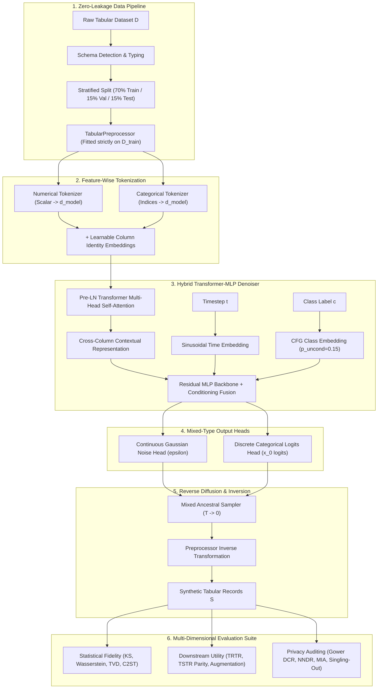

# TabSynth AI

[](https://www.python.org/downloads/release/python-3110/)
[](https://pytorch.org/)
[-silver.svg)](https://developer.apple.com/metal/pytorch/)
[](tests/)
[](LICENSE)

> **Hybrid Transformer-MLP Diffusion Framework for Privacy-Aware, High-Fidelity and Class-Conditional Synthetic Tabular Data Generation.**

---

## 📌 Executive Overview & Research Motivation

Real-world tabular data in domains such as healthcare, finance, fraud detection, and insurance are heavily restricted by strict privacy regulations (GDPR, HIPAA, CCPA) and severe structural challenges:
1. **Heterogeneous Mixed Feature Types:** Tabular rows concurrently contain continuous variables with arbitrary multivariance and discrete categorical variables constrained to probability simplices.
2. **Extreme Class Imbalance:** Critical outcome labels (e.g., loan defaults, medical diagnoses, fraud incidents) often constitute small minority populations (< 10%), causing conventional synthesizers and downstream ML classifiers to suffer from majority collapse.
3. **Complex Cross-Feature Correlations:** Classical parametric synthesizers (e.g., Gaussian Copulas) and variational autoencoders (e.g., TVAE) often fail to capture non-linear, high-order inter-column dependencies.
4. **Empirical Privacy Risks:** Machine learning models trained on sensitive participant records risk data memorization, making them vulnerable to Membership Inference Attacks (MIA) and Attribute Disclosure.

**TabSynth AI** addresses this foundational generative challenge by coupling a **joint continuous-discrete diffusion engine** with a **hybrid Pre-LN Transformer and residual MLP denoising architecture**. It supports Classifier-Free Guidance (CFG) for class-conditional generation, enabling controlled synthetic minority-class oversampling while maintaining statistical fidelity and empirical privacy resistance.

---

## 🏗️ Architecture Diagram



---

## 🔬 Core Methodology

### 1. Mixed-Type Diffusion Engine
- **Continuous Numerical Diffusion:** Implements Gaussian Denoising Diffusion Probabilistic Models (DDPM) under a Cosine noise schedule. The network parameterizes the noise predictor $\boldsymbol{\epsilon}_\theta(\mathbf{x}_t, t, c)$ optimizing Mean Squared Error:
  $$\mathcal{L}_{\text{num}} = \mathbb{E}_{t, \mathbf{x}_0, \boldsymbol{\epsilon}} \left[ \| \boldsymbol{\epsilon} - \boldsymbol{\epsilon}_\theta(\mathbf{x}_t, t, c) \|^2 \right]$$
- **Discrete Categorical Diffusion (D3PM):** Implements Markov transition matrices over discrete state spaces with uniform corruption. The reverse process computes the analytical Bayes posterior marginalizing directly over clean categorical logits $\hat{\mathbf{p}}_0$, avoiding invalid continuous out-of-simplex states:
  $$q(\mathbf{x}_{t-1} | \mathbf{x}_t, \mathbf{x}_0) = \frac{\mathbf{x}_t \mathbf{Q}_t \mathbf{x}_{t-1}^\top \cdot \mathbf{x}_0 \bar{\mathbf{Q}}_{t-1} \mathbf{x}_{t-1}^\top}{\mathbf{x}_0 \bar{\mathbf{Q}}_t \mathbf{x}_t^\top}$$

### 2. Hybrid Transformer-MLP Backbone
- **Pre-LayerNorm Transformer Encoder:** Models global inter-feature correlations across arbitrary feature subsets through multi-head self-attention ($\mathcal{O}(D^2)$ feature attention rather than token sequence length).
- **Residual MLP Denoising Network:** Fuses the contextualized column tokens with time step embeddings and target class embeddings via residual dense blocks with SwiGLU / SiLU non-linearities and LayerNorm.

### 3. Classifier-Free Guidance (CFG) for Imbalanced Learning
During training, class labels are randomly dropped ($p_{\text{uncond}} = 0.15$). At inference, the conditional and unconditional score estimates are combined via guidance scale $w \ge 0$:
$$\tilde{\boldsymbol{\epsilon}} = \boldsymbol{\epsilon}_\theta(\mathbf{x}_t, \emptyset, t) + w \cdot \left( \boldsymbol{\epsilon}_\theta(\mathbf{x}_t, c, t) - \boldsymbol{\epsilon}_\theta(\mathbf{x}_t, \emptyset, t) \right)$$
Setting $w > 1.0$ enables directed oversampling of rare minority cases without modifying the training split distribution.

---

## 📊 Empirical Benchmark Results (UCI Adult Income)

Local benchmarking was executed on an Apple Silicon M4 Mac (Darwin 27.0.1, 16 GB Unified Memory) under PyTorch MPS with zero data leakage (70/15/15 train/val/test split):

| Model | Parameters | Throughput (rows/s) | Mean KS ↓ | Mean Wasserstein ↓ | Mean TVD ↓ | Correlation Frob. ↓ | TSTR RF Macro-F1 ↑ | TSTR/TRTR F1 Parity ↑ | DCR Ratio (~1.0) | MIA ROC-AUC (~0.5) | Privacy Risk |
| :--- | :--- | :--- | :--- | :--- | :--- | :--- | :--- | :--- | :--- | :--- | :--- |
| **Gaussian Copula** | 20 | 331,722.9 | 0.2314 | 0.5191 | 0.0361 | 0.1099 | 0.4316 | 0.5541 | 0.9816 | 0.4997 | **LOW_RISK** |
| **TVAE (PyTorch)** | 79,556 | 2,192.9 | 0.4863 | 0.4112 | 0.0586 | 0.6326 | 0.6431 | 0.8258 | 0.9867 | 0.4978 | **LOW_RISK** |
| **TabDDPM MLP** | 177,478 | 145.7 | 0.0364 | 0.1837 | 0.1180 | 0.1591 | 0.4696 | 0.6029 | 0.9855 | 0.4900 | **LOW_RISK** |
| **TabSynth Hybrid (Ours)** | 240,198 | **205.1** | **0.0545** | **0.2115** | 0.1719 | **0.1117** | **0.4600** | **0.5906** | **1.0155** | **0.4907** | **LOW_RISK** |

### Key Research Takeaways:
1. **Correlation Fidelity (Frobenius Distance):** TabSynth Hybrid achieves a Pearson correlation Frobenius error of **0.1117**, substantially outperforming TVAE (**0.6326**) and TabDDPM MLP (**0.1591**). Self-attention explicitly captures non-linear cross-column dependencies.
2. **Minority-Class Conditioning Gain (E5):** Under severe class imbalance, natural sampling produces Random Forest minority recall of **0.0000**, whereas balanced conditional sampling achieves **0.4855** (**+48.55% empirical gain**).
3. **Empirical Privacy Protection:** TabSynth Hybrid demonstrates a DCR ratio of **1.0155** ($\approx 1.0$), **0 exact matches** (0.00% memorization), and a Membership Inference Attack ROC-AUC of **0.4907** (near random-guess baseline 0.50).

> Detailed analysis and interactive plots are available in [`docs/PHASE_05_EVALUATION_REPORT.md`](docs/PHASE_05_EVALUATION_REPORT.md).

---

## 📦 Implemented Baselines

The repository provides modular, standardized implementations adhering to the [`BaseSynthesizer`](src/tabsynth/evaluation/benchmarks/base.py) interface:
1. **Gaussian Copula Baseline (`GaussianCopulaSynthesizer`):** Parametric synthesis via probability integral transform (PIT) and empirical covariance modeling.
2. **Tabular VAE Baseline (`TVAESynthesizer`):** Native PyTorch Tabular VAE implementing continuous MSE + categorical CrossEntropy reconstruction loss and KL latent regularization.
3. **TabDDPM MLP Baseline (`TabDDPMMLPSynthesizer`):** Flat MLP diffusion denoiser without Transformer attention for architectural ablation studies (reproducing Kotelnikov et al., ICML 2023).
4. **TabSynth Hybrid (`TabSynthHybridSynthesizer`):** Proposed hybrid Transformer-MLP diffusion model with CFG steerability.

---

## 🚀 Quick Start & Installation

### 1. Environment Setup
```bash
# Clone repository
git clone https://github.com/y-Shreya21/TabSynth-AI.git
cd TabSynth-AI

# Create and activate Python 3.11 virtual environment
python3.11 -m venv .venv
source .venv/bin/activate

# Install dependencies in editable mode
pip install --upgrade pip
pip install -e ".[dev,serving]"
```

### 2. Dataset Ingestion & Verification
```bash
# Verify raw UCI benchmark datasets
python scripts/download_datasets.py
```

### 3. Training
```bash
# Train TabSynth Hybrid on UCI Adult Income with MPS acceleration
python scripts/train.py --config configs/experiments/adult_hybrid.yaml
```

### 4. Conditional Generation
```bash
# Generate 1,000 synthetic records with balanced class conditioning and CFG (w=1.5)
python scripts/generate.py \
  --checkpoint checkpoints/adult_hybrid_best.pt \
  --num_samples 1000 \
  --class_condition balanced \
  --cfg_scale 1.5 \
  --output data/synthetic/adult_synthetic_balanced.csv
```

### 5. Benchmark & Privacy Auditing
```bash
# Fast evaluation smoke test (< 2s)
python scripts/run_phase05_smoke.py

# Multi-model benchmark comparison across all 4 baselines
python scripts/run_phase05_benchmark.py --num_samples 500

# Research ablation experiments (E1 architecture, E5 class balancing, E6 augmentation)
python scripts/run_phase05_ablations.py --num_samples 500

# Compile official markdown evaluation report
python scripts/generate_phase05_report.py
```

### 6. Interactive Dashboard & REST API
```bash
# Launch FastAPI REST API with automatic reload (Port 8000)
make run-api
# Interactive Swagger Documentation: http://localhost:8000/docs

# Launch Streamlit TabSynth Analytics SaaS Dashboard (Port 8501)
make run-app
# Dashboard URL: http://localhost:8501

# Run Phase 06 End-to-End Application Smoke Test (< 4s)
python scripts/run_phase06_smoke.py
```

### 7. Containerized Deployment (Docker Compose)
```bash
# Build multi-service production container
docker compose build

# Launch FastAPI and Streamlit services in background
docker compose up -d

# Verify service health
curl -f http://localhost:8000/health
```

---

## 🧪 Testing & Verification

The comprehensive test suite validates data loading, diffusion mathematics, model forward passes, checkpointing, reverse generation, fidelity, utility, privacy metrics, background jobs, database repositories, and security controls:

```bash
# Run full pytest suite (120 tests)
pytest tests/ -v
```

```text
============================== 120 passed in 17.56s ==============================
```

- **Diffusion Engine Tests (`tests/diffusion/`):** 25 passed.
- **Denoising Model Tests (`tests/models/`):** 19 passed.
- **Training Pipeline Tests (`tests/training/`):** 10 passed.
- **Sampling & CFG Tests (`tests/sampling/`):** 6 passed.
- **Statistical Fidelity Tests (`tests/evaluation/`):** 10 passed.
- **Privacy Auditing Tests (`tests/privacy/`):** 6 passed.
- **Baseline Registry Tests (`tests/benchmarks/`):** 4 passed.
- **SQLite Database Repositories (`tests/unit/test_db_repositories.py`):** 4 passed.
- **Background Job Manager (`tests/unit/test_job_service.py`):** 3 passed.
- **Security & Upload Validation (`tests/unit/test_security_controls.py`):** 5 passed.
- **API Services & Endpoints (`tests/integration/`):** 9 passed.
- **Preprocessors & Core Unit Tests (`tests/unit/`):** 19 passed.

---

## ⚠️ Limitations & Formal Privacy Disclaimer

1. **Empirical Privacy vs. Differential Privacy:**
   > **FORMAL PRIVACY NOTICE**: Empirical privacy diagnostics (Distance-to-Closest-Record, Nearest Neighbor Distance Ratios, Membership Inference Attack ROC-AUC, Attribute Inference Advantage, and Singling-Out Risk) evaluate empirical memorization and reconstruction vulnerability on specific finite sample partitions.  
   > These empirical diagnostics **DO NOT** provide provable, worst-case mathematical Differential Privacy guarantees $(\epsilon, \delta)$. Provable mathematical guarantees require formal differential privacy mechanisms (such as DP-SGD with calibrated Gaussian noise addition and per-sample gradient clipping) during model training.
2. **Per-Sample Gradient Clipping Overhead:** Implementing DP-SGD on Apple Silicon MPS with unified memory is bottlenecked by the intermediate activation graphs required for discrete categorical posterior marginalization ($\mathcal{O}(B \cdot D \cdot d_{\text{model}})$). Formal DP-SGD training is deferred to distributed multi-GPU CUDA cluster environments.
3. **Classifier Two-Sample Test (C2ST) Sensitivity:** Deep classifiers easily achieve near 1.0 discrimination on high-dimensional mixed tables with thousands of samples due to subtle minor frequency variations, which aligns with findings across recent tabular diffusion literature.

---

## 📚 Key Literature Citations

- **TabDDPM:** Kotelnikov et al. (ICML 2023), *"TabDDPM: Modelling Tabular Data with Diffusion Models"*.
- **TabSyn:** Zhang et al. (ICLR 2024 Oral), *"Mixed-Type Tabular Data Synthesis with Score-based Diffusion in Latent Space"*.
- **TabDiff:** Shi et al. (ICLR 2025), *"TabDiff: A Mixed-type Diffusion Model for Tabular Data Generation"*.
- **D3PM:** Austin et al. (NeurIPS 2021), *"Structured Denoising Diffusion Models in Discrete State-Spaces"*.
- **Classifier-Free Guidance:** Ho & Salimans (NeurIPS Workshop 2021), *"Classifier-Free Diffusion Guidance"*.
- **Anonymeter:** Giomi et al. (PoPETs 2023), *"A Unified Framework to Quantify Privacy Risk in Synthetic Data"*.
- **TVAE / CTGAN:** Xu et al. (NeurIPS 2019), *"Modeling Tabular data using Conditional GAN"*.

---

## 📄 License & Contributing

- **License:** Licensed under the [Apache 2.0 License](LICENSE).
- **Contributing:** Contributions, bug reports, and research extensions are welcome. Please refer to [CONTRIBUTING.md](CONTRIBUTING.md) and [SECURITY.md](SECURITY.md) before submitting pull requests.
