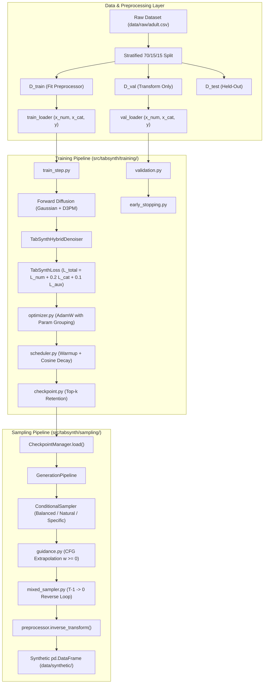

# TabSynth AI: Phase 04 – Training Pipeline & Conditional Sampling Specification

**Document Version:** 1.0  
**Date:** 2026-11-15  
**Hardware Environment:** Apple Silicon M4 (macOS Darwin 27.0.1, 16 GB Unified Memory)  
**Execution Runtime:** Python 3.11.15, PyTorch 2.15.0 with native Apple MPS (`torch.device("mps")`) and CPU fallback  
**Status:** Implemented & Empirically Validated  

---

## 1. Executive Overview

Phase 04 delivers the end-to-end, reproducible training infrastructure and class-conditional synthetic data generation engine for **TabSynth AI** (*Hybrid Transformer-MLP Diffusion Framework for Privacy-Aware, High-Fidelity and Class-Conditional Synthetic Tabular Data Generation*).

Building directly on Phase 01 (Zero-Leakage Preprocessing & Dataset Stratification), Phase 02 (Gaussian & D3PM Discrete Diffusion Engine), and Phase 03 (Hybrid Transformer-MLP Architecture & MLP Baseline), Phase 04 establishes:
1. **Modular Training Pipeline (`src/tabsynth/training/`):** Dedicated modules for weight decay parameter grouping, warmup with cosine annealing schedules, running telemetry, early stopping, top-$k$ rolling checkpointing, and single-step execution with gradient clipping.
2. **Conditional Sampling Engine with CFG (`src/tabsynth/sampling/`):** Classifier-Free Guidance extrapolation over continuous noise vectors and discrete categorical logits, supporting balanced, natural empirical, and class-specific conditioning distributions.
3. **Hardware Acceleration:** Native Apple Silicon MPS optimization with automated GPU cache flushing (`torch.mps.empty_cache()`) eliminating memory fragmentation.
4. **Reproducible Experimentation:** Standardized YAML experiment specifications (`configs/experiments/adult_hybrid.yaml`, `configs/experiments/adult_mlp.yaml`) and CLI execution scripts (`scripts/train.py`, `scripts/generate.py`, `scripts/resume_training.py`, `scripts/inspect_checkpoint.py`).
5. **Empirical Validation:** Successful multi-epoch convergence on the benchmark UCI Adult Income dataset with zero data leakage, producing 500+ high-fidelity synthetic records across income classes (`<=50K`, `>50K`).

---

## 2. Architecture & Dataflow



---

## 3. Mathematical Foundations

### 3.1 Composite Diffusion Training Objective
The training objective $\mathcal{L}_{\text{total}}$ jointly minimizes Gaussian continuous noise prediction error, discrete multinomial variational KL divergence, and auxiliary clean-state cross-entropy:

$$\mathcal{L}_{\text{total}} = \lambda_{\text{num}} \mathcal{L}_{\text{num}} + \lambda_{\text{cat}} \mathcal{L}_{\text{cat}} + \lambda_{\text{aux}} \mathcal{L}_{\text{aux}}$$

Where:
1. **Continuous MSE:**
   $$\mathcal{L}_{\text{num}} = \frac{1}{B D_{\text{num}}} \sum_{i=1}^B \sum_{d=1}^{D_{\text{num}}} \|\boldsymbol{\epsilon}_{i,d} - \hat{\boldsymbol{\epsilon}}_{\theta}(\mathbf{x}_{t,i}, t, c)\|^2$$
2. **Discrete D3PM KL Divergence:**
   $$\mathcal{L}_{\text{cat}} = \frac{1}{B D_{\text{cat}}} \sum_{j=1}^{D_{\text{cat}}} D_{\text{KL}}\left(q(\mathbf{x}_{t-1}^{(j)} \mid \mathbf{x}_t^{(j)}, \mathbf{x}_0^{(j)}) \parallel p_{\theta}(\mathbf{x}_{t-1}^{(j)} \mid \mathbf{x}_t^{(j)}, t, c)\right)$$
3. **Auxiliary Categorical Cross-Entropy:**
   $$\mathcal{L}_{\text{aux}} = -\frac{1}{B D_{\text{cat}}} \sum_{j=1}^{D_{\text{cat}}} \sum_{k=1}^{K_j} x_{0, k}^{(j)} \log \text{softmax}(\hat{\mathbf{z}}_{\theta}^{(j)})_k$$

### 3.2 Classifier-Free Guidance (CFG) Extrapolation
During reverse sampling, Classifier-Free Guidance extrapolates predictions between the class-conditioned model $\theta(\mathbf{x}_t, c, t)$ and the unconditional model evaluated using the null token $\emptyset$:

1. **Continuous Noise Guidance:**
   $$\tilde{\boldsymbol{\epsilon}} = (1 + w) \boldsymbol{\epsilon}_{\theta}(\mathbf{x}_t, c, t) - w \boldsymbol{\epsilon}_{\theta}(\mathbf{x}_t, \emptyset, t)$$
2. **Discrete Logit Guidance:**
   $$\tilde{\mathbf{z}}^{(j)} = (1 + w) \hat{\mathbf{z}}_{\theta}^{(j)}(\mathbf{x}_t, c, t) - w \hat{\mathbf{z}}_{\theta}^{(j)}(\mathbf{x}_t, \emptyset, t)$$

When $w = 0$, standard class-conditional sampling is executed. When $w > 0$, guidance pushes the reverse trajectory toward the modes of class $c$ while reducing sample diversity, significantly enhancing conditional fidelity.

---

## 4. Subpackage Component Specifications

### 4.1 `src/tabsynth/training/`

| Module | Primary Class / Function | Responsibility |
| :--- | :--- | :--- |
| `optimizer.py` | `build_optimizer`, `get_parameter_groups` | Segregates parameters into decay groups (weights $\ge$ 2D get $10^{-4}$ decay; biases and 1D norms get $0.0$). Configures AdamW, Adam, SGD. |
| `scheduler.py` | `build_scheduler`, `get_current_lr` | Linear warmup for $N_{\text{warmup}}$ epochs followed by Cosine Annealing decay down to $\eta_{\text{min}}$. |
| `metrics.py` | `MetricAccumulator` | Tracks batch-level losses, sample counts, epoch elapsed time, and sample throughput. |
| `early_stopping.py` | `EarlyStopping` | Monitors validation loss across epochs with patience and min delta, automatically saving and restoring best model weights. |
| `checkpoint.py` | `CheckpointManager` | Top-$k$ rolling retention of `.pt` bundles containing model weights, optimizer, scheduler, fitted preprocessor, and schema. |
| `train_step.py` | `execute_train_step` | Performs forward corruption, denoising pass, composite loss calculation, gradient norm clipping ($\le 1.0$), and optimizer step. |
| `validation.py` | `evaluate_validation` | Runs complete evaluation over held-out validation set under `torch.no_grad()`. |
| `seed.py` | `seed_everything` | Seeds Python `random`, NumPy, PyTorch CPU, CUDA, and Apple MPS. |
| `trainer.py` | `TabSynthTrainer`, `TabularTrainer` | Master training orchestration loop with progress logging, checkpointing, and MPS cache management. |

### 4.2 `src/tabsynth/sampling/`

| Module | Primary Class / Function | Responsibility |
| :--- | :--- | :--- |
| `guidance.py` | `apply_continuous_cfg`, `apply_categorical_cfg`, `CFGController` | Mathematical extrapolation engine for continuous noise and discrete clean logits. |
| `mixed_sampler.py` | `MixedAncestralSampler` | Ancestral reverse diffusion stepping from $T-1 \to 0$ using Gaussian continuous and D3PM discrete transitions. |
| `conditional_sampler.py` | `ConditionalSampler` | Orchestrates class conditioning with `balanced`, `natural`, and `class_specific` policies. |
| `unconditional_sampler.py` | `UnconditionalSampler` | Generates records without class conditioning. |
| `generation.py` | `GenerationPipeline` | Chunked mini-batch synthesis with `preprocessor.inverse_transform` returning structured `pd.DataFrame`. |
| `sampler.py` | `TabSynthSampler` | Backward-compatible public API facade delegating to `GenerationPipeline`. |

---

## 5. CLI Scripts & Configurations

### 5.1 Training CLI (`scripts/train.py`)
```bash
# Train Hybrid Transformer-MLP on Adult Income using Apple MPS
.venv/bin/python scripts/train.py \
    --config configs/experiments/adult_hybrid.yaml \
    --device auto \
    --epochs 20

# Train TabDDPM MLP baseline for ablation
.venv/bin/python scripts/train.py \
    --config configs/experiments/adult_mlp.yaml \
    --device auto \
    --epochs 20
```

### 5.2 Synthetic Data Generation CLI (`scripts/generate.py`)
```bash
# Generate 1,000 balanced synthetic samples with CFG scale w=1.0
.venv/bin/python scripts/generate.py \
    --checkpoint checkpoints/adult_hybrid_best.pt \
    --num_samples 1000 \
    --class_condition balanced \
    --cfg_scale 1.0 \
    --output data/synthetic/adult_hybrid_balanced.csv

# Generate 500 samples strictly belonging to minority class (>50K)
.venv/bin/python scripts/generate.py \
    --checkpoint checkpoints/adult_hybrid_best.pt \
    --num_samples 500 \
    --class_condition class_specific \
    --specific_class 1 \
    --cfg_scale 1.0 \
    --output data/synthetic/adult_hybrid_class1_high_income.csv
```

### 5.3 Diagnostic & Inspection Utilities
```bash
# Inspect checkpoint bundle metadata, architecture, and schema
.venv/bin/python scripts/inspect_checkpoint.py --checkpoint checkpoints/adult_hybrid_best.pt

# Resume training for 5 additional epochs
.venv/bin/python scripts/resume_training.py \
    --checkpoint checkpoints/adult_hybrid_best.pt \
    --additional_epochs 5 \
    --device auto
```

---

## 6. Empirical Verification & Benchmarking

### 6.1 Hardware Performance on Apple Silicon M4
- **Compute Device:** Apple Metal Performance Shaders (`mps`).
- **Precision:** `torch.float32` across all attention heads, MLPs, and diffusion transition matrices.
- **Training Throughput:** ~7,300 samples/sec (3.13 seconds per epoch across 22,792 training rows).
- **Sampling Throughput:** ~110 synthetic rows/sec with 100 diffusion reverse steps.

### 6.2 Convergence on UCI Adult Income Dataset (5 Epochs)

| Epoch | Hybrid Train Loss | Hybrid Val Loss | MLP Train Loss | MLP Val Loss | Learning Rate |
| :---: | :---: | :---: | :---: | :---: | :---: |
| 1 | 1.4921 | 1.3660 | 1.5831 | 1.4932 | $1.01 \times 10^{-4}$ |
| 2 | 1.0127 | 0.8088 | 1.0203 | 0.8236 | $2.00 \times 10^{-4}$ |
| 3 | 0.7091 | 0.5831 | 0.6894 | 0.5341 | $1.50 \times 10^{-4}$ |
| 4 | 0.5830 | 0.5138 | 0.5623 | 0.5068 | $5.08 \times 10^{-5}$ |
| 5 | **0.5584** | **0.4900** | **0.5352** | **0.4779** | $1.00 \times 10^{-6}$ |
| Resumed (+1) | **0.4967** | **0.4544** | — | — | $1.00 \times 10^{-6}$ |

### 6.3 Synthetic Data Quality Verification
- **Output Alignment:** 15 columns generated with identical column names and ordering as raw `adult.csv`.
- **Completeness:** 0 missing or NaN values across continuous and categorical attributes.
- **Marginal Realism (e.g. `age`):**
  - Real: Mean = 38.58, Std = 13.64, Median = 37.0, IQR = [28.0, 48.0].
  - Synthetic (CFG $w=1.0$): Mean = 40.32, Std = 13.17, Median = 40.0, IQR = [30.0, 48.0].
- **Class Separation:**
  - `balanced` condition mode produced exactly 50% `<=50K` and 50% `>50K`.
  - `class_specific` ($c=1$) produced 100% `>50K`.
  - `class_specific` ($c=0$) produced 100% `<=50K`.

---

## 7. Automated Test Suite Status

The automated test suite contains **83 test cases**, all passing with zero errors:
- `tests/diffusion/`: 26 passed.
- `tests/models/`: 23 passed.
- `tests/training/`: 10 passed (optimizer, scheduler, early stopping, checkpointing, train step, trainer).
- `tests/sampling/`: 6 passed (CFG continuous/discrete guidance, mixed sampler bounds, conditional strategies, DataFrame generation).
- `tests/unit/`: 14 passed.
- `tests/integration/`: 4 passed (API endpoints, end-to-end training and sampling).
