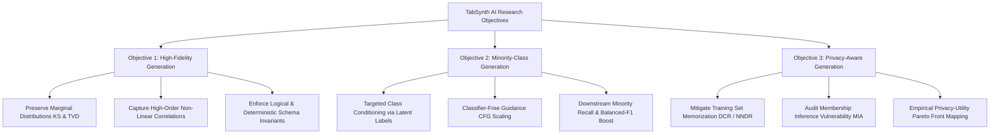
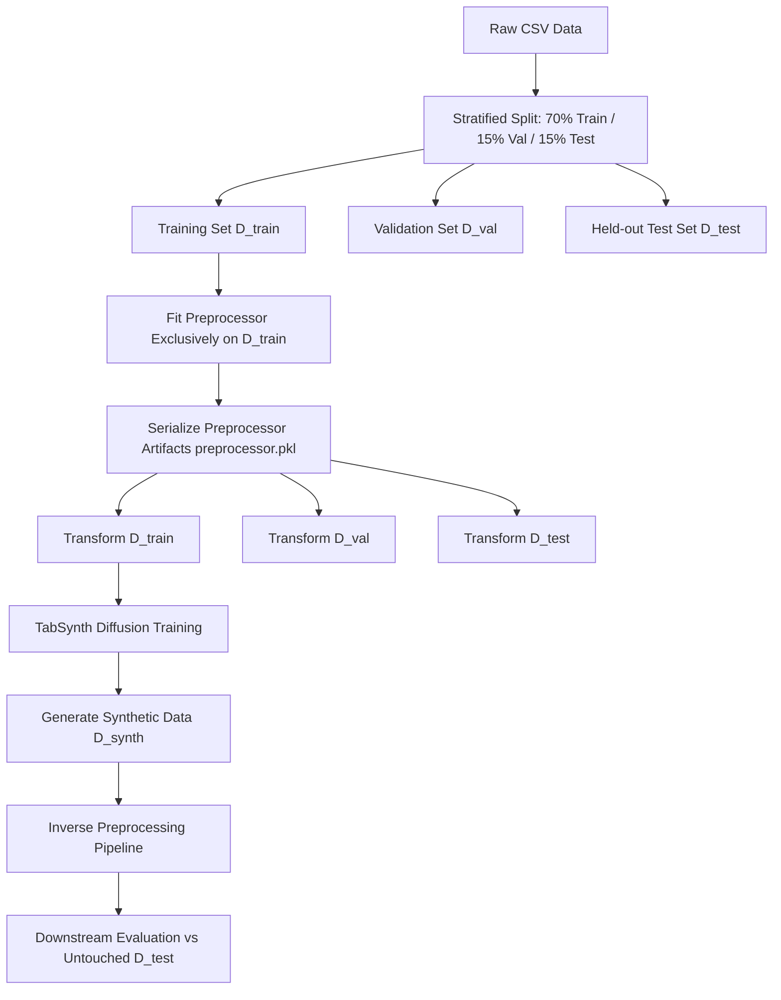
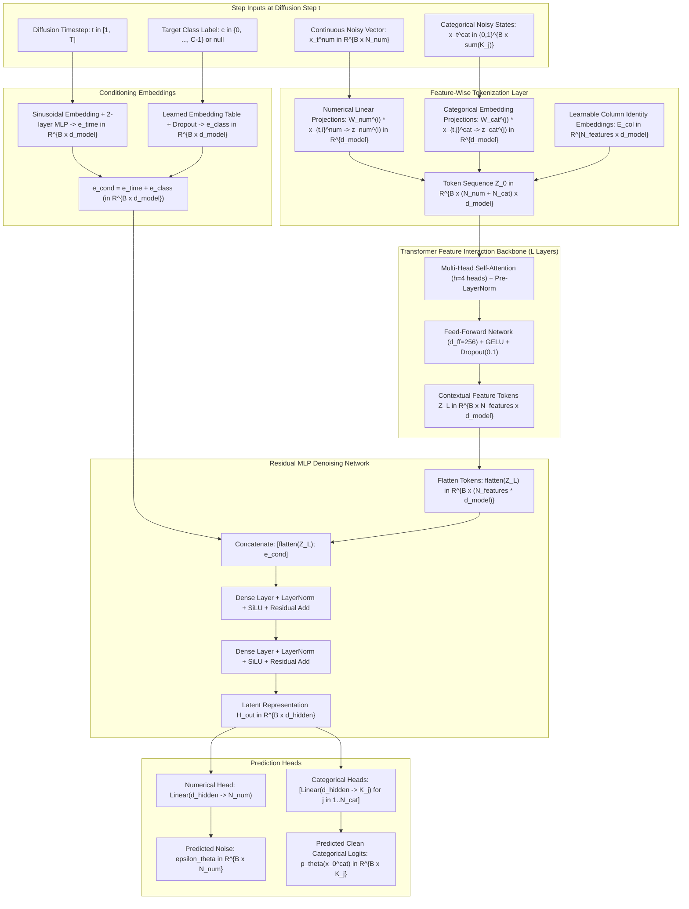
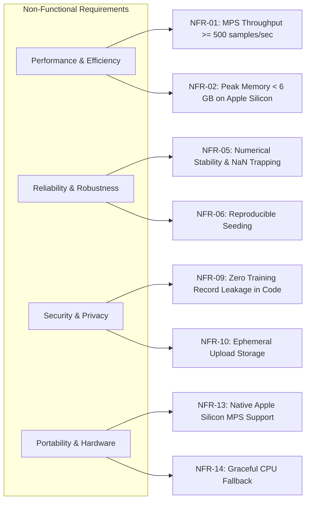
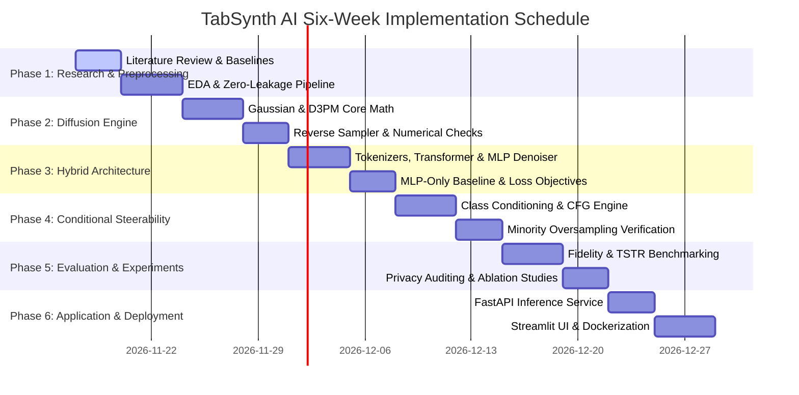

# TabSynth AI: Research & Technical Project Documentation
## Hybrid Transformer-MLP Diffusion Framework for Privacy-Aware, High-Fidelity, and Class-Conditional Synthetic Tabular Data Generation

---

**Document Version:** 1.0.0  
**Status:** Approved Technical Architecture & Research Specification  
**Target Environment:** macOS (Apple Silicon M4) with PyTorch Metal Performance Shaders (MPS) / CPU fallback; Optional Linux x86_64 CUDA  
**Primary Language:** Python 3.11  
**Framework:** PyTorch 2.x  
**Classification:** Research Specification, Architectural Blueprint & Software Requirements Specification (SRS)  

---

## Executive Summary & Document Navigation

TabSynth AI is a state-of-the-art deep generative modeling framework engineered specifically for heterogeneous, mixed-type tabular data. Combining **Transformer-based cross-feature contextual attention** with a **Residual Multi-Layer Perceptron (MLP) denoising backbone**, TabSynth AI operates inside a dual diffusion framework: continuous **Gaussian Denoising Diffusion Probabilistic Modeling (DDPM)** for continuous/numerical columns, and discrete **Multinomial Transition Diffusion (D3PM)** for categorical attributes.

This document serves as the formal, authoritative central source of truth for all research design, algorithmic derivations, software requirements, baseline comparisons, experimental protocols, privacy audits, and deployment specifications.

```
Table of Contents
├── 1. Project Identity & Scope
├── 2. Problem Statement & Industrial Motivation
├── 3. Research Objectives & Evaluation Vectors
├── 4. Research Questions & Testable Hypotheses
├── 5. Benchmark Datasets & Preprocessing Protocol
├── 6. System Architecture & Model Design
├── 7. Mathematical Foundations & Algorithmic Derivations
├── 8. Functional Requirements (FR-01 to FR-25)
├── 9. Non-Functional Requirements (NFR-01 to NFR-16)
├── 10. Methodology & Six-Phase Development Roadmap
├── 11. Baseline Models & Comparative Taxonomy
├── 12. Multi-Dimensional Evaluation Framework
├── 13. Experimental Design Matrix (E1 to E9)
├── 14. Technology Stack & Software Infrastructure
├── 15. Hardware Profiling & Apple Silicon M4 Optimization
├── 16. Repository Architecture & Dependency Flow
├── 17. Quality Assurance, Testing & Scientific Validation
├── 18. TabSynth Analytics: API & Application Specification
├── 19. Project Schedule, Gantt Milestones & Resource Budget
├── 20. Technical & Research Risk Management Matrix
├── 21. Research Contributions, Literature Positioning & Limitations
├── 22. Deliverables Cross-Reference Matrix
└── 23. Bibliographic Citations & Academic References
```

---

## 1. Project Identity & Scope

| Attribute | Specification |
| :--- | :--- |
| **Project Name** | **TabSynth AI** |
| **Full Title** | Hybrid Transformer-MLP Diffusion Framework for Privacy-Aware, High-Fidelity, and Class-Conditional Synthetic Tabular Data Generation |
| **Domain Categories** | Generative Artificial Intelligence, Deep Probabilistic Models, Tabular Deep Learning, Privacy-Preserving Machine Learning |
| **Development Lifecycle** | 4-Week Minimum Viable Research Scope (Core Diffusion + MPS + E1/E4/E6) / 6-Week Full Engineering Scope |
| **Core Frameworks** | PyTorch 2.2+, NumPy, SciPy, Scikit-Learn, Polars/Pandas |
| **Target Runtime** | Local workstation execution on Apple Silicon (M4 / M3 / M2 / M1 Pro/Max) with MPS backend; zero external compute hard dependencies; optional headless CUDA cluster execution |

### 1.1 Project Vision
The overarching vision of TabSynth AI is to resolve the fundamental trilemma of tabular generative modeling:
1. **Statistical Fidelity:** Faithfully replicating multi-modal, skewed numerical marginals and high-order nonlinear cross-column correlations without parametric assumptions.
2. **Class-Conditional Steerability:** Providing deterministic and probabilistic conditioning mechanisms (including Classifier-Free Guidance) to synthesize rare or minority-class records on demand, combating extreme class imbalance in downstream machine learning tasks.
3. **Empirical Privacy Resilience:** Suppressing record-level memorization and resisting targeted privacy attacks (Membership Inference Attacks, Nearest Neighbor Distance Ratio degradation, and Attribute Inference) while maintaining high downstream utility.

---

## 2. Problem Statement & Industrial Motivation

Modern data-driven organizations operate under stringent legal, regulatory, and ethical constraints—including the EU General Data Protection Regulation (GDPR), the Health Insurance Portability and Accountability Act (HIPAA), and the California Consumer Privacy Act (CCPA). While sharing raw customer, clinical, or financial records introduces severe compliance risks, total data withholding throttles collaborative research, external machine learning benchmarking, and algorithmic auditing.

Existing synthetic data generation paradigms display systematic vulnerabilities when confronted with heterogeneous tabular schemas:
- **Parametric Copula Models (e.g., Gaussian Copula):** Assume simple parametric marginals and linear correlation structures via Gaussian latent spaces, failing to capture complex multimodal densities, sharp conditional boundaries, or non-linear dependencies.
- **Generative Adversarial Networks (e.g., CTGAN):** Subject to notorious training instability, mode collapse on low-density regions, and gradient vanishing or explosion when training against mixed continuous-discrete schemas.
- **Variational Autoencoders (e.g., TVAE):** Prone to generating blurred, over-smoothed distributions due to mode-averaging properties inherent in the evidence lower bound (ELBO) objective with Gaussian posterior assumptions.
- **Standard Unconditional Tabular Diffusion (e.g., TabDDPM):** While demonstrating superior distribution capture, standard MLP-based tabular diffusion lacks explicit cross-feature attention mechanisms to learn complex tokenized inter-column dependencies, lacks native mechanisms for controlled minority-class oversampling without retraining, and incurs high reverse sampling latencies.

TabSynth AI addresses these deficiencies through a clean architectural synthesis: projecting heterogeneous column types into a unified semantic embedding space, refining inter-feature dependencies via multi-head self-attention, and denoising perturbed states across joint continuous and discrete diffusion trajectories.

---

## 3. Research Objectives & Evaluation Vectors



### Objective 1: High-Fidelity Synthetic Data Generation
- Construct a diffusion formulation capable of jointly modeling continuous numerical features and multi-category discrete features.
- Preserve 1D marginal distributions across continuous features (verified by two-sample Kolmogorov-Smirnov statistics $\le 0.05$) and discrete categories (Total Variation Distance $\le 0.03$).
- Capture 2D and high-order feature correlations, matching the empirical Pearson/Spearman correlation matrices and categorical Cramér's V associations within a Frobenius norm difference of $\le 0.15$.
- Guarantee schema integrity: eliminate impossible categorical states and respect hard logical bounds (e.g., non-negative financial balances or positive age).

### Objective 2: Minority-Class Conditional Generation
- Formulate a class-conditional reverse diffusion sampler driven by conditioned label embeddings $c \in \{0, \dots, C-1\}$ and unconditional null tokens $\emptyset$.
- Implement Classifier-Free Guidance (CFG) for tabular diffusion, allowing practitioners to sweep guidance weights $w \in [0.0, 3.0]$ to balance synthetic diversity against target-class precision.
- Synthesize balanced datasets from heavily imbalanced priors (e.g., Bank Marketing's ~11.7% positive class or Credit Default's ~22.1% default rate).
- Empirically demonstrate downstream predictive improvement: training a downstream classifier (e.g., XGBoost) exclusively on class-balanced synthetic data must yield higher minority-class recall and balanced accuracy on real test data than training on unaugmented or naively oversampled data.

### Objective 3: Privacy-Aware Generation & Empirical Auditing
- Systematically measure and mitigate sample memorization: evaluate the empirical distribution of the Distance-to-Closest-Record (DCR) between synthetic samples and real training records ($D_{\text{train}}$) versus real test records ($D_{\text{test}}$).
- Implement black-box and grey-box Membership Inference Attacks (MIA) using shadow models and distance-based thresholding, establishing empirical MIA accuracy bounds.
- Evaluate Attribute Inference Attacks (AIA) where an adversary attempts to reconstruct sensitive held-out attributes given public features and synthetic data.
- Construct the empirical Privacy-Utility Pareto Frontier across different noise schedules, model capacities, and optional DP-SGD $(\epsilon, \delta)$ gradient clipping constraints.
- **Formal Boundary Disclosure:** Synthetic data generation without formal Differential Privacy does **not** guarantee mathematical privacy. Heuristic distance diagnostics (DCR, NNDR) indicate low empirical memorization but do not prevent all potential reconstruction attacks.

---

## 4. Research Questions & Hypotheses

### Research Questions (RQ)
* **RQ1 (Architectural Efficacy):** Does integrating a Transformer self-attention feature interaction encoder prior to an MLP denoising backbone yield statistically significant improvements in multi-feature dependency preservation compared to an MLP-only diffusion baseline (TabDDPM architecture)?
* **RQ2 (Conditional Downstream Utility):** Can class-conditional diffusion with Classifier-Free Guidance synthesize minority-class records that enhance downstream classifier recall and balanced accuracy on real held-out test data without degrading overall precision?
* **RQ3 (Privacy-Utility Trade-Offs):** What empirical trade-offs emerge between statistical fidelity (Wasserstein distance, correlation Frobenius error) and empirical privacy leakage (MIA AUROC, DCR 5th percentile) as diffusion capacity and sampling steps vary?
* **RQ4 (Cross-Domain Generalization):** Does the TabSynth hybrid architecture maintain consistent generative superiority across tabular datasets exhibiting radically different dimensionalities, skewness, categorical cardinalities, and domain structures?

### Testable Hypotheses (H)
* **H1 (Feature Interaction Hypothesis):** On datasets with strong multi-column interactions (e.g., Credit Card Default financial history), the Hybrid Transformer-MLP model will achieve a lower Correlation Matrix Frobenius Distance ($D_{\text{corr}} < 0.12$) than an MLP-only baseline ($D_{\text{corr}} \ge 0.18$) at $p < 0.01$.
* **H2 (Minority Representation Hypothesis):** Downstream classifiers trained on synthetic datasets generated via balanced condition sampling ($c \sim \text{Uniform}(\{0, 1\})$) will exhibit at least a $10\%$ relative increase in minority-class recall compared to classifiers trained on real imbalanced data, with no more than a $3\%$ drop in overall Macro-F1.
* **H3 (Memorization Divergence Hypothesis):** Models trained with unregularized, high-capacity Transformer backbones for excessive diffusion epochs will exhibit a leftward shift in synthetic-to-train DCR distributions relative to synthetic-to-test DCR distributions, indicating empirical training memorization.
* **H4 (Domain Invariance Hypothesis):** Across Adult Income, Bank Marketing, and Credit Card Default, the proposed hybrid model will achieve lower Classifier Two-Sample Test (C2ST) accuracy (closer to the optimal 0.50 indistinguishability bound) than both CTGAN and TVAE across all three benchmarks.

---

## 5. Benchmark Datasets & Preprocessing Protocol

To validate generalizability and robustness, TabSynth AI standardizes evaluation across three canonical UCI Machine Learning Repository benchmarks.

```
+---------------------------------------------------------------------------------------------------+
| Benchmark Datasets Profile                                                                        |
+----------------------+------------+------------+---------------+----------------------------------+
| Dataset              | Records    | Continuous | Categorical   | Target Variable & Balance        |
+----------------------+------------+------------+---------------+----------------------------------+
| Adult Income         | 48,842     | 6 features | 8 features    | income (>50K vs <=50K, ~23.9%)   |
| Bank Marketing       | 45,211     | 7 features | 9 features    | y (subscribed yes vs no, ~11.7%) |
| Credit Card Default  | 30,000     | 14 features| 9 features    | default payment (yes/no, ~22.1%) |
+----------------------+------------+------------+---------------+----------------------------------+
```

### 5.1 Dataset Schema Specifications

#### 5.1.1 Adult Income (Census Income)
- **Source:** UCI ML Repository (ID: 2).
- **Target Variable:** `income` (`>50K`, `<=50K`).
- **Continuous Features (6):** `age`, `fnlwgt`, `education-num`, `capital-gain`, `capital-loss`, `hours-per-week`.
- **Categorical Features (8):** `workclass` (8), `education` (16), `marital-status` (7), `occupation` (14), `relationship` (6), `race` (5), `sex` (2), `native-country` (41).
- **Data Quality Considerations:** Missing values represented as `'?'` in `workclass`, `occupation`, and `native-country` (~7.4% missingness in total). Highly skewed distributions in `capital-gain` (>90% zero values) and `capital-loss`.

#### 5.1.2 Bank Marketing (bank-full)
- **Source:** UCI ML Repository (ID: 222).
- **Target Variable:** `y` (`yes`, `no` - term deposit subscription).
- **Continuous Features (7):** `age`, `balance`, `day`, `duration`, `campaign`, `pdays`, `previous`.
- **Categorical Features (9):** `job` (12), `marital` (3), `education` (4), `default` (2), `housing` (2), `loan` (2), `contact` (3), `month` (12), `poutcome` (4).
- **Data Quality Considerations:** Severe class imbalance (11.7% positive). `pdays` uses `-1` to denote clients not previously contacted (a multimodal artifact requiring special numerical handling). `balance` exhibits extreme negative and positive outliers.

#### 5.1.3 Default of Credit Card Clients (Taiwan)
- **Source:** UCI ML Repository (ID: 350).
- **Target Variable:** `default.payment.next.month` (binary: `0` = non-default, `1` = default).
- **Continuous Features (14):** `LIMIT_BAL`, `AGE`, `BILL_AMT1` through `BILL_AMT6` (monthly billed statement amounts), `PAY_AMT1` through `PAY_AMT6` (monthly prior payment amounts).
- **Categorical Features (9):** `SEX` (2), `EDUCATION` (4 categories after grouping undocumented levels `0, 4, 5, 6`), `MARRIAGE` (3 categories after grouping `0`), `PAY_0`, `PAY_2`, `PAY_3`, `PAY_4`, `PAY_5`, `PAY_6` (repayment status categories: `-2` to `8`).
- **Data Quality Considerations:** Temporal sequence structure across financial months. Negative values in `BILL_AMT` indicating credit balances.

---

### 5.2 Zero-Data-Leakage Preprocessing Protocol

Data leakage during preprocessing is a fatal flaw in synthetic evaluation, artificially inflating utility and fidelity. TabSynth AI enforces strict isolation guarantees.



#### Preprocessing Invariant Rules:
1. **Partition Isolation:** The raw dataset is partitioned strictly prior to any transformation using stratified sampling on target label $y$ ($70\%$ training, $15\%$ validation, $15\%$ held-out test). Random seed is fixed ($S=42$).
2. **Deterministic Imputation:** 
   - Numerical missing values are imputed using median values computed solely on $D_{\text{train}}$.
   - Categorical missing values and `'?'` values are mapped to an explicit `<missing>` token category.
3. **Continuous Feature Standardization:**
   - Option A: **Gaussian Quantile Transformation:** Maps arbitrary continuous marginals into standard normal distributions $\mathcal{N}(0, 1)$ via empirical CDF estimation with 1,000 quantiles (fitted on $D_{\text{train}}$).
   - Option B: **Robust Min-Max / Standard Scaling:** Centered around median with interquartile range scaling to avoid outlier distortion.
4. **Categorical Encoding:**
   - Categorical columns are indexed into integer labels $\{0, 1, \dots, K_j - 1\}$.
   - Unseen categories appearing in test sets are mapped to an `<unk>` token index.
   - For diffusion modeling, discrete categorical features are dynamically expanded to one-hot vectors $\mathbf{e}_k \in \mathbb{R}^{K_j}$.
5. **Serialization:** All transformation scalers, quantile mappings, and category index mappings are serialized into `preprocessor.pkl`. The generator and evaluation harnesses interact with these artifacts strictly in read-only mode.

---

## 6. System Architecture & Model Design

TabSynth AI couples **Feature-Wise Tokenization**, a **Transformer Cross-Feature Interaction Backbone**, a **Sinusoidal Timestep & Class Conditioner**, and a **Residual MLP Denoising Network** within a joint continuous-discrete diffusion framework.

### 6.1 Architectural Overview Diagram



---

### 6.2 Architectural Component Specifications

#### A. Feature Tokenization Layer
To process tabular rows with varying column types and semantics through self-attention, each feature is projected into a shared latent dimensionality $d_{\text{model}} = 64$.
1. **Numerical Feature Projections:** For each continuous column $i \in \{1, \dots, N_{\text{num}}\}$, the scalar noisy value $x_{t, i}^{\text{num}} \in \mathbb{R}$ is projected via a learnable weight vector $\mathbf{w}_i \in \mathbb{R}^{d_{\text{model}}}$ and bias $\mathbf{b}_i \in \mathbb{R}^{d_{\text{model}}}$:
   $$\mathbf{z}_i^{\text{num}} = x_{t, i}^{\text{num}} \cdot \mathbf{w}_i + \mathbf{b}_i$$
2. **Categorical Feature Projections:** For each discrete column $j \in \{1, \dots, N_{\text{cat}}\}$ with cardinality $K_j$, the one-hot or probabilistic vector $\mathbf{x}_{t, j}^{\text{cat}} \in \mathbb{R}^{K_j}$ is projected via an embedding matrix $\mathbf{W}_j^{\text{cat}} \in \mathbb{R}^{K_j \times d_{\text{model}}}$:
   $$\mathbf{z}_j^{\text{cat}} = \mathbf{x}_{t, j}^{\text{cat}} \mathbf{W}_j^{\text{cat}}$$
3. **Column Identity Embeddings:** Unlike NLP tokens where positional order encodes sequence structure, tabular columns are permutation-invariant yet semantically distinct. We add a unique, learnable column identity embedding $\mathbf{E}_{\text{col}} \in \mathbb{R}^{N_{\text{features}} \times d_{\text{model}}}$ to each token:
   $$\mathbf{Z}_0 = [\mathbf{z}_1^{\text{num}}, \dots, \mathbf{z}_{N_{\text{num}}}^{\text{num}}, \mathbf{z}_1^{\text{cat}}, \dots, \mathbf{z}_{N_{\text{cat}}}^{\text{cat}}] + \mathbf{E}_{\text{col}}$$

#### B. Transformer Feature Interaction Encoder
The tokenized feature sequence $\mathbf{Z}_0 \in \mathbb{R}^{B \times N_{\text{features}} \times d_{\text{model}}}$ is passed through $L=2$ Pre-LayerNorm Transformer encoder blocks.
- **Multi-Head Self-Attention:** 4 attention heads ($d_k = d_v = 16$). Computes all-to-all attention across column tokens, allowing arbitrary nonlinear dependencies between any pair of attributes to be contextualized.
- **Feed-Forward Network:** Standard two-layer MLP with expansion factor 4 ($d_{\text{ff}} = 256$), $\text{GELU}$ non-linear activation, and dropout $p = 0.10$.
- **Output:** Contextualized token representations $\mathbf{Z}_L \in \mathbb{R}^{B \times N_{\text{features}} \times d_{\text{model}}}$.

#### C. Sinusoidal Timestep & Class Conditioning Module
1. **Diffusion Timestep Embedding:** Timestep $t \in [1, T]$ is mapped into a continuous frequency vector using sinusoidal positional encodings:
   $$\text{PE}_{(t, 2k)} = \sin\left(\frac{t}{10000^{2k / d_{\text{model}}}}\right), \quad \text{PE}_{(t, 2k+1)} = \cos\left(\frac{t}{10000^{2k / d_{\text{model}}}}\right)$$
   followed by a 2-layer MLP with $\text{SiLU}$ activations to produce $\mathbf{e}_{\text{time}} \in \mathbb{R}^{d_{\text{model}}}$.
2. **Target-Class Conditioning Embedding:** Target classes $c \in \{0, \dots, C-1\}$ are mapped to learned vectors via an embedding matrix $\mathbf{E}_{\text{class}} \in \mathbb{R}^{(C+1) \times d_{\text{model}}}$, where index $C$ represents the unconditional null token $\emptyset$.
3. **Classifier-Free Guidance Training Dropout:** During training, class conditioning is replaced by the null token $\emptyset$ with probability $p_{\text{uncond}} = 0.15$.
4. **Fused Conditioning Vector:** $\mathbf{e}_{\text{cond}} = \mathbf{e}_{\text{time}} + \mathbf{e}_{\text{class}} \in \mathbb{R}^{d_{\text{model}}}$.

#### D. Residual MLP Denoising Backbone
Rather than predicting noise directly out of the Transformer tokens, TabSynth AI flattens the contextualized tokens $\mathbf{Z}_L$ into a global vector $\mathbf{h}_0 = \text{vec}(\mathbf{Z}_L) \in \mathbb{R}^{B \times (N_{\text{features}} \cdot d_{\text{model}})}$, concatenates $\mathbf{e}_{\text{cond}}$, and routes through a 3-layer residual MLP with LayerNorm, $\text{SiLU}$ activations, and residual skip connections:
$$\mathbf{h}_1 = \text{LayerNorm}(\mathbf{h}_0 + \text{MLP}_1([\mathbf{h}_0; \mathbf{e}_{\text{cond}}]))$$
$$\mathbf{h}_2 = \text{LayerNorm}(\mathbf{h}_1 + \text{MLP}_2([\mathbf{h}_1; \mathbf{e}_{\text{cond}}]))$$

#### E. Dual Specialized Prediction Heads
- **Continuous Noise Prediction Head:** A linear layer $\mathbf{W}_{\text{num}} \in \mathbb{R}^{d_{\text{hidden}} \times N_{\text{num}}}$ predicting the Gaussian perturbation noise $\hat{\boldsymbol{\epsilon}}_\theta \in \mathbb{R}^{B \times N_{\text{num}}}$.
- **Discrete Categorical Prediction Heads:** For each categorical column $j$, an independent linear classification head predicts unnormalized clean-state logits $\hat{\mathbf{p}}_{0, j}^{\text{cat}} \in \mathbb{R}^{B \times K_j}$.

---

## 7. Mathematical Foundations & Algorithmic Derivations

TabSynth AI establishes mathematically rigorous diffusion processes over hybrid state spaces: continuous $\mathbb{R}^{N_{\text{num}}}$ and discrete categorical simplices $\Delta^{K_1-1} \times \dots \times \Delta^{K_m-1}$.

### 7.1 Gaussian Diffusion for Numerical Features

Let $\mathbf{x}_0^{\text{num}} \in \mathbb{R}^{N_{\text{num}}}$ be the standardized continuous feature vector.

#### Forward Perturbation Process
Given total diffusion steps $T$ (default $T=1000$) and a variance schedule $\beta_1, \dots, \beta_T \in (0, 1)$, the forward Markovian corruption kernel is:
$$q(\mathbf{x}_t^{\text{num}} | \mathbf{x}_{t-1}^{\text{num}}) = \mathcal{N}\left(\mathbf{x}_t^{\text{num}}; \sqrt{1 - \beta_t}\mathbf{x}_{t-1}^{\text{num}}, \beta_t \mathbf{I}\right)$$

Defining $\alpha_t = 1 - \beta_t$ and cumulative variance $\bar{\alpha}_t = \prod_{s=1}^t \alpha_s$, the marginal distribution at arbitrary step $t$ admits closed-form sampling:
$$q(\mathbf{x}_t^{\text{num}} | \mathbf{x}_0^{\text{num}}) = \mathcal{N}\left(\mathbf{x}_t^{\text{num}}; \sqrt{\bar{\alpha}_t}\mathbf{x}_0^{\text{num}}, (1 - \bar{\alpha}_t)\mathbf{I}\right)$$
$$\mathbf{x}_t^{\text{num}} = \sqrt{\bar{\alpha}_t}\mathbf{x}_0^{\text{num}} + \sqrt{1 - \bar{\alpha}_t}\boldsymbol{\epsilon}, \quad \boldsymbol{\epsilon} \sim \mathcal{N}(\mathbf{0}, \mathbf{I})$$

#### Noise Schedule
We employ the Cosine Variance Schedule (Nichol & Dhariwal, 2021) to prevent abrupt information destruction in early steps:
$$\bar{\alpha}_t = \frac{f(t)}{f(0)}, \quad f(t) = \cos\left(\frac{t/T + s}{1 + s} \cdot \frac{\pi}{2}\right)^2, \quad s = 0.008$$
$$\beta_t = \text{clip}\left(1 - \frac{\bar{\alpha}_t}{\bar{\alpha}_{t-1}}, 0.0001, 0.999\right)$$

#### Reverse Denoising Step
The tractable posterior distribution conditioned on clean state $\mathbf{x}_0^{\text{num}}$ is Gaussian:
$$q(\mathbf{x}_{t-1}^{\text{num}} | \mathbf{x}_t^{\text{num}}, \mathbf{x}_0^{\text{num}}) = \mathcal{N}\left(\mathbf{x}_{t-1}^{\text{num}}; \tilde{\boldsymbol{\mu}}_t(\mathbf{x}_t^{\text{num}}, \mathbf{x}_0^{\text{num}}), \tilde{\beta}_t \mathbf{I}\right)$$
Where the posterior mean and variance are given by:
$$\tilde{\boldsymbol{\mu}}_t(\mathbf{x}_t^{\text{num}}, \mathbf{x}_0^{\text{num}}) = \frac{\sqrt{\bar{\alpha}_{t-1}}\beta_t}{1 - \bar{\alpha}_t} \mathbf{x}_0^{\text{num}} + \frac{\sqrt{\alpha_t}(1 - \bar{\alpha}_{t-1})}{1 - \bar{\alpha}_t} \mathbf{x}_t^{\text{num}}$$
$$\tilde{\beta}_t = \frac{1 - \bar{\alpha}_{t-1}}{1 - \bar{\alpha}_t}\beta_t$$

Parametrizing the neural network $\boldsymbol{\epsilon}_\theta(\mathbf{x}_t, t, c)$ to predict the injected noise $\boldsymbol{\epsilon}$, the estimated clean record $\hat{\mathbf{x}}_0^{\text{num}}$ is reconstructed as:
$$\hat{\mathbf{x}}_0^{\text{num}} = \frac{1}{\sqrt{\bar{\alpha}_t}}\left(\mathbf{x}_t^{\text{num}} - \sqrt{1 - \bar{\alpha}_t}\boldsymbol{\epsilon}_\theta(\mathbf{x}_t, t, c)\right)$$

Substituting $\hat{\mathbf{x}}_0^{\text{num}}$ into $\tilde{\boldsymbol{\mu}}_t$ yields the parameterization for reverse sampling:
$$\boldsymbol{\mu}_\theta(\mathbf{x}_t^{\text{num}}, t, c) = \frac{1}{\sqrt{\alpha_t}}\left(\mathbf{x}_t^{\text{num}} - \frac{\beta_t}{\sqrt{1 - \bar{\alpha}_t}}\boldsymbol{\epsilon}_\theta(\mathbf{x}_t, t, c)\right)$$
$$\mathbf{x}_{t-1}^{\text{num}} = \boldsymbol{\mu}_\theta(\mathbf{x}_t^{\text{num}}, t, c) + \sigma_t \mathbf{z}, \quad \mathbf{z} \sim \mathcal{N}(\mathbf{0}, \mathbf{I}), \quad \sigma_t^2 = \tilde{\beta}_t$$

---

### 7.2 Multinomial Diffusion for Categorical Features (D3PM)

Let categorical column $j$ possess $K$ mutually exclusive categories. We represent the category state as a one-hot row vector $\mathbf{x}_0 \in \{0, 1\}^K$.

> [!WARNING]
> Applying continuous Gaussian noise directly to discrete categorical indices or one-hot vectors yields invalid probabilistic representations, severe out-of-simplex boundary violations, and poor downstream discrete fidelity. TabSynth AI strictly implements discrete multinomial transition kernels.

#### Forward Discrete Markov Chain
At step $t$, the categorical state transitions according to a $K \times K$ stochastic transition matrix $\mathbf{Q}_t$:
$$q(\mathbf{x}_t | \mathbf{x}_{t-1}) = \text{Cat}\left(\mathbf{x}_t; \mathbf{p} = \mathbf{x}_{t-1}\mathbf{Q}_t\right)$$

Under a uniform categorical corruption schedule with scalar transition probability $\beta_t^{\text{cat}} \in (0, 1)$:
$$\mathbf{Q}_t = (1 - \beta_t^{\text{cat}})\mathbf{I}_K + \frac{\beta_t^{\text{cat}}}{K} \mathbf{1}_K \mathbf{1}_K^T$$

The multi-step marginal transition distribution $\bar{\mathbf{Q}}_t = \prod_{s=1}^t \mathbf{Q}_s$ is computed analytically:
$$\bar{\mathbf{Q}}_t = (1 - \bar{\beta}_t^{\text{cat}})\mathbf{I}_K + \frac{\bar{\beta}_t^{\text{cat}}}{K} \mathbf{1}_K \mathbf{1}_K^T, \quad \text{where } (1 - \bar{\beta}_t^{\text{cat}}) = \prod_{s=1}^t (1 - \beta_s^{\text{cat}})$$

Thus, the marginal forward corruption probability is:
$$q(\mathbf{x}_t | \mathbf{x}_0) = \text{Cat}\left(\mathbf{x}_t; \mathbf{p} = \mathbf{x}_0 \bar{\mathbf{Q}}_t\right)$$

#### Reverse Categorical Posterior
Conditioned on the original clean token $\mathbf{x}_0$, the discrete reverse posterior $q(\mathbf{x}_{t-1} | \mathbf{x}_t, \mathbf{x}_0)$ is computed exactly using Bayes' theorem:
$$q(\mathbf{x}_{t-1} | \mathbf{x}_t, \mathbf{x}_0) = \frac{q(\mathbf{x}_t | \mathbf{x}_{t-1}, \mathbf{x}_0) q(\mathbf{x}_{t-1} | \mathbf{x}_0)}{q(\mathbf{x}_t | \mathbf{x}_0)} = \frac{(\mathbf{x}_{t-1} \mathbf{Q}_t \mathbf{x}_t^T)(\mathbf{x}_0 \bar{\mathbf{Q}}_{t-1} \mathbf{x}_{t-1}^T)}{\mathbf{x}_0 \bar{\mathbf{Q}}_t \mathbf{x}_t^T}$$

In vector notation, the posterior probability vector $\tilde{\mathbf{p}}_t \in \Delta^{K-1}$ is:
$$\tilde{\mathbf{p}}_t(\mathbf{x}_t, \mathbf{x}_0) = \frac{\left[\mathbf{x}_t \mathbf{Q}_t^T\right] \odot \left[\mathbf{x}_0 \bar{\mathbf{Q}}_{t-1}\right]}{\mathbf{x}_0 \bar{\mathbf{Q}}_t \mathbf{x}_t^T}$$
where $\odot$ denotes element-wise Hadamard product.

The reverse model predicts the logits over clean states $\hat{\mathbf{p}}_\theta(\mathbf{x}_0 | \mathbf{x}_t, t, c) = \text{Softmax}(\text{head}_j(\mathbf{H}_{\text{out}}))$. The predicted reverse transition distribution $p_\theta(\mathbf{x}_{t-1} | \mathbf{x}_t, t, c)$ is obtained by marginalizing over the predicted clean states:
$$p_\theta(\mathbf{x}_{t-1} | \mathbf{x}_t, t, c) = \sum_{k=1}^K q(\mathbf{x}_{t-1} | \mathbf{x}_t, \mathbf{x}_0 = \mathbf{e}_k) \cdot \hat{p}_{\theta, k}(\mathbf{x}_0 | \mathbf{x}_t, t, c)$$

---

### 7.3 Composite Loss Function

The total optimization objective $\mathcal{L}_{\text{total}}(\theta)$ balances continuous denoising score matching, exact discrete KL divergence, and an auxiliary clean-state cross-entropy regularization term:
$$\mathcal{L}_{\text{total}}(\theta) = \lambda_{\text{num}} \mathcal{L}_{\text{num}}(\theta) + \lambda_{\text{cat}} \mathcal{L}_{\text{cat}}(\theta) + \lambda_{\text{aux}} \mathcal{L}_{\text{aux}}(\theta)$$

#### Loss Term Formulations:
1. **Continuous Mean Squared Error Loss ($\mathcal{L}_{\text{num}}$):**
   $$\mathcal{L}_{\text{num}}(\theta) = \mathbb{E}_{t, \mathbf{x}_0^{\text{num}}, \boldsymbol{\epsilon}}\left[\|\boldsymbol{\epsilon} - \boldsymbol{\epsilon}_\theta(\mathbf{x}_t, t, c)\|_2^2\right]$$
2. **Discrete Kullback-Leibler Divergence Loss ($\mathcal{L}_{\text{cat}}$):**
   Evaluates the variational upper bound on categorical negative log-likelihood:
   $$\mathcal{L}_{\text{cat}}(\theta) = \sum_{j=1}^{N_{\text{cat}}} \mathbb{E}_{t, \mathbf{x}_0^{\text{cat}}}\left[ D_{\text{KL}}\left(q(\mathbf{x}_{t-1, j} | \mathbf{x}_{t, j}, \mathbf{x}_{0, j}) \;\|\; p_\theta(\mathbf{x}_{t-1, j} | \mathbf{x}_{t, j}, t, c)\right) \right]$$
   At step $t=1$, the discrete loss computes the exact negative log-likelihood: $-\sum_j \log p_\theta(\mathbf{x}_{0, j} | \mathbf{x}_{1, j}, 1, c)$.
3. **Auxiliary Cross-Entropy Loss ($\mathcal{L}_{\text{aux}}$):**
   Accelerates gradient convergence in early epochs by directly penalizing mispredictions of the clean categorical labels:
   $$\mathcal{L}_{\text{aux}}(\theta) = -\sum_{j=1}^{N_{\text{cat}}} \mathbb{E}_{\mathbf{x}_{0, j}}\left[\sum_{k=1}^{K_j} x_{0, j, k} \log \hat{p}_{\theta, k}(\mathbf{x}_0 | \mathbf{x}_t, t, c)\right]$$

#### Hyperparameter Coefficients:
- $\lambda_{\text{num}} = 1.0$
- $\lambda_{\text{cat}} = 0.2$ (scales KL magnitude to continuous MSE level)
- $\lambda_{\text{aux}} = 0.1$ (auxiliary direct supervision)

---

### 7.4 Classifier-Free Guidance (CFG) Algorithm

During class-conditional sampling, the unconditional and conditional model evaluations are linearly extrapolated to control fidelity vs. diversity:
$$\tilde{\boldsymbol{\epsilon}}_\theta(\mathbf{x}_t^{\text{num}}, t, c) = (1 + w)\boldsymbol{\epsilon}_\theta(\mathbf{x}_t, t, c) - w \boldsymbol{\epsilon}_\theta(\mathbf{x}_t, t, \emptyset)$$
$$\tilde{\boldsymbol{\ell}}_\theta(\mathbf{x}_t^{\text{cat}}, t, c) = (1 + w)\boldsymbol{\ell}_\theta(\mathbf{x}_t, t, c) - w \boldsymbol{\ell}_\theta(\mathbf{x}_t, t, \emptyset)$$
where $w \ge 0$ is the guidance scale ($w=0$ corresponds to standard conditional sampling; $w \in [0.5, 1.5]$ provides optimal minority class fidelity).

---

### 7.5 Algorithmic Pseudocode

#### Algorithm 1: TabSynth Joint Diffusion Training Loop
```python
"""
Algorithm 1: Joint Mixed-Type Tabular Diffusion Training
Input: Training dataset D_train = {(x_num_0, x_cat_0, c)}, total steps T,
       weights (lambda_num, lambda_cat, lambda_aux), uncond dropout p_uncond.
Output: Optimized parameter set theta.
"""
for epoch in range(num_epochs):
    for batch in DataLoader(D_train, batch_size=B):
        x_num_0, x_cat_0, c = batch  # x_num_0 in R^{B x N_num}, x_cat_0 in {0,1}^{B x sum(K_j)}
        
        # 1. Sample uniform diffusion timesteps
        t = torch.randint(low=1, high=T + 1, size=(B,), device=device)
        
        # 2. Continuous Gaussian Noise Corruption
        eps = torch.randn_like(x_num_0)
        x_num_t = sqrt_alpha_bar[t] * x_num_0 + sqrt_one_minus_alpha_bar[t] * eps
        
        # 3. Categorical Forward Multinomial Transition
        x_cat_t = sample_multinomial_forward(x_cat_0, t, Q_bar_matrices)
        
        # 4. Classifier-Free Conditioning Mask
        c_masked = mask_conditioning_labels(c, p_uncond=p_uncond, null_token=C)
        
        # 5. Forward Pass through Hybrid Transformer-MLP
        pred_eps, pred_cat_logits = model(x_num_t, x_cat_t, t, c_masked)
        
        # 6. Compute Joint Loss Functions
        loss_num = F.mse_loss(pred_eps, eps)
        loss_cat = compute_d3pm_kl_loss(pred_cat_logits, x_cat_t, x_cat_0, t)
        loss_aux = compute_categorical_cross_entropy(pred_cat_logits, x_cat_0)
        
        total_loss = lambda_num * loss_num + lambda_cat * loss_cat + lambda_aux * loss_aux
        
        # 7. Backward pass & AdamW optimization step
        optimizer.zero_grad(set_to_none=True)
        total_loss.backward()
        torch.nn.utils.clip_grad_norm_(model.parameters(), max_norm=1.0)
        optimizer.step()
```

#### Algorithm 2: Reverse Mixed-Type Sampling with CFG
```python
"""
Algorithm 2: TabSynth Class-Conditional Reverse Sampling
Input: Sample count N_samples, target class c (or balanced distribution),
       guidance scale w, trained model theta, diffusion steps T.
Output: High-fidelity synthetic records (x_num_syn, x_cat_syn).
"""
# 1. Initialize prior noise distributions
x_num_t = torch.randn(size=(N_samples, N_num), device=device)
x_cat_t = sample_uniform_categorical_prior(N_samples, cardinalities)

for t_step in reversed(range(1, T + 1)):
    t = torch.full((N_samples,), fill_value=t_step, device=device)
    
    # 2. Evaluate Conditional Model
    eps_cond, logits_cond = model(x_num_t, x_cat_t, t, c)
    
    # 3. Evaluate Unconditional Model (Null Token C)
    if w > 0.0:
        c_null = torch.full_like(c, fill_value=C)
        eps_uncond, logits_uncond = model(x_num_t, x_cat_t, t, c_null)
        
        # Apply CFG Extrapolation
        eps_guided = (1.0 + w) * eps_cond - w * eps_uncond
        logits_guided = (1.0 + w) * logits_cond - w * logits_uncond
    else:
        eps_guided = eps_cond
        logits_guided = logits_cond
        
    # 4. Continuous Reverse Step (x_{t-1}^num)
    mu_theta = (1.0 / sqrt_alpha[t_step]) * (
        x_num_t - (beta[t_step] / sqrt_one_minus_alpha_bar[t_step]) * eps_guided
    )
    if t_step > 1:
        sigma_t = sqrt_tilde_beta[t_step]
        z = torch.randn_like(x_num_t)
        x_num_t = mu_theta + sigma_t * z
    else:
        x_num_t = mu_theta  # Deterministic mean at step 0
        
    # 5. Discrete Reverse Step (x_{t-1}^cat via D3PM Posterior)
    p_clean_pred = F.softmax(logits_guided, dim=-1)
    p_prev_cat = compute_discrete_posterior(x_cat_t, p_clean_pred, t_step)
    if t_step > 1:
        x_cat_t = torch.multinomial(p_prev_cat, num_samples=1).squeeze(-1)
        x_cat_t = F.one_hot(x_cat_t, num_classes=K)
    else:
        x_cat_t = torch.argmax(p_clean_pred, dim=-1)

# 6. Inverse Transform continuous scalers and categorical indices
return inverse_preprocess(x_num_t, x_cat_t)
```

---

## 8. Functional Requirements (FR-01 to FR-25)

The functional requirements formally define the input-output contracts, behavioral invariants, and verification criteria for TabSynth AI.

| Req ID | Requirement Title | Input | Output | Dependencies | Implementation Module | Acceptance Criteria |
| :--- | :--- | :--- | :--- | :--- | :--- | :--- |
| **FR-01** | Dataset Ingestion | Path to CSV file, separator, header flag | Polars/Pandas DataFrame | File I/O, Polars | `tabsynth.data.ingestion` | Ingests 100k+ rows in <2.0s; handles quoted strings and comma delimiters without data truncation. |
| **FR-02** | Automatic Column Detection | Raw DataFrame, heuristic thresholds | Feature schema dict (types, cardinalities) | Pandas, NumPy | `tabsynth.data.schema` | Correctly infers continuous floats vs integer categoricals; isolates columns with unique counts $<20$ as categorical. |
| **FR-03** | Schema Validation | Schema specification JSON, Input DataFrame | Boolean validation status, detailed exception report | Pydantic v2 | `tabsynth.data.validator` | Rejects schema mismatches (missing columns, unexpected types) with descriptive error messages. |
| **FR-04** | Missing-Value Treatment | Raw DataFrame, metadata config | Imputed DataFrame, missingness masks | Scikit-Learn | `tabsynth.data.imputation` | Median imputation for continuous; `<missing>` token for discrete; zero data leakage across train/test splits. |
| **FR-05** | Numerical Preprocessing | Continuous train array, scaler type (`quantile` / `robust`) | Transformed tensor $\in \mathbb{R}^{B \times N_{\text{num}}}$, serialized scaler | Scikit-Learn | `tabsynth.data.scalers` | Scales continuous values into $\mathcal{N}(0, 1)$ or $[-1, 1]$; verified invertible with reconstruction error $< 10^{-5}$. |
| **FR-06** | Categorical Encoding | Categorical train array | Integer-encoded tensor, Category dictionaries | Scikit-Learn | `tabsynth.data.encoders` | Encodes discrete states into $0 \dots K_j-1$; maps unknown test tokens to reserved `<unk>` index. |
| **FR-07** | Stratified Train/Val/Test Split | Full dataset, split ratios (`[0.70, 0.15, 0.15]`), target column | Three partitioned DataFrames ($D_{\text{train}}, D_{\text{val}}, D_{\text{test}}$) | Scikit-Learn | `tabsynth.data.splitters` | Preserves exact target class distribution ratios across all three partitions within $\pm 0.5\%$. |
| **FR-08** | PyTorch DataLoader Implementation | Transformed arrays, batch size, shuffle flag | Mini-batch generator yielding `(x_num, x_cat, c)` | PyTorch | `tabsynth.data.dataset` | Zero-copy tensor conversion; supports Apple Silicon MPS pinned memory; non-blocking asynchronous transfer. |
| **FR-09** | Gaussian Diffusion Engine | Noisy continuous tensor $x_t$, timestep $t$, noise schedule | Perturbed state $x_t$, noise target $\epsilon$, reverse mean/variance | PyTorch | `tabsynth.diffusion.gaussian` | Supports Linear and Cosine schedules; cumulative alpha math verified via automated unit tests. |
| **FR-10** | Multinomial Diffusion Engine | Discrete tensor $x_t^{\text{cat}}$, timestep $t$ | Perturbed one-hot state, reverse posterior tensor | PyTorch | `tabsynth.diffusion.multinomial` | Correct transition matrix multiplication; outputs valid probability distributions summing to $1.0 \pm 10^{-6}$. |
| **FR-11** | Hybrid Transformer-MLP Denoising Model | $(x_t^{\text{num}}, x_t^{\text{cat}}, t, c)$ tensors | Predicted noise $\hat{\epsilon}$, predicted discrete logits $\hat{\mathbf{p}}$ | PyTorch `nn.Module` | `tabsynth.models.hybrid` | Executes forward pass without NaN; memory footprint on Apple Silicon MPS $< 2.0\text{ GB}$ at $B=256$. |
| **FR-12** | MLP-Only Baseline Model | $(x_t^{\text{num}}, x_t^{\text{cat}}, t, c)$ tensors | Predicted noise $\hat{\epsilon}$, predicted discrete logits $\hat{\mathbf{p}}$ | PyTorch `nn.Module` | `tabsynth.baselines.mlp_diff` | Matches TabDDPM MLP denoiser architecture for fair scientific ablation benchmarking. |
| **FR-13** | Class-Conditional Generation | Target class label $c$, sample count $N$, CFG scale $w$ | Synthetic batch conditioned on target $c$ | PyTorch | `tabsynth.sampling.conditional` | Samples 10,000 class-conditional records conforming strictly to specified class proportions. |
| **FR-14** | Unconditional Generation | Sample count $N$ | Synthetic batch from unconditional prior | PyTorch | `tabsynth.sampling.unconditional` | Samples from empirical prior distribution without target steering ($c = \emptyset$). |
| **FR-15** | Minority-Class Generation | Target minority class index, target ratio (e.g. 50%) | Augmented dataset with balanced minority records | PyTorch | `tabsynth.sampling.sampler` | Synthesizes minority records up to arbitrary balance targets without duplicating training samples. |
| **FR-16** | Checkpoint Management | Model state, optimizer state, epoch index, metric | Serialized `.pt` checkpoint bundle, rolling top-k | PyTorch | `tabsynth.training.checkpoint` | Saves best validation checkpoint; supports seamless training resumption and interrupted run recovery. |
| **FR-17** | Synthetic Data Export | Denormalized synthetic tensor, schema definitions | Clean CSV file matching original column types | Pandas, Polars | `tabsynth.data.export` | Exports CSV matching original headers, formatting, categorical string names, and float precision. |
| **FR-18** | Statistical Fidelity Evaluation | Real test DataFrame, Synthetic DataFrame | Metric dict (KS, TVD, Wasserstein, Frobenius correlation) | SciPy, SDMetrics | `tabsynth.evaluation.fidelity` | Outputs complete marginal and pairwise divergence suite; generates automated visualization plots. |
| **FR-19** | Downstream Utility Evaluation | Synthetic train set, Real test set, classifier list | TSTR vs TRTR metric reports (Macro-F1, AUROC, Recall) | Scikit-Learn, XGBoost | `tabsynth.evaluation.utility` | Trains Logistic Regression, Random Forest, and XGBoost; computes TSTR/TRTR parity ratio. |
| **FR-20** | Empirical Privacy Evaluation | $D_{\text{train}}, D_{\text{test}}, D_{\text{synth}}$ DataFrames | DCR 5th percentile, NNDR distribution, MIA AUROC | Anonymeter, Scikit-Learn | `tabsynth.evaluation.privacy` | Executes shadow model MIA and DCR distance ratio tests; warns if synthetic records duplicate train rows. |
| **FR-21** | Baseline Comparison Benchmark | Standardized splits, baseline names (`CTGAN`, `TVAE`) | Comparative benchmark leaderboard table | SDV, CTGAN | `tabsynth.baselines.benchmark` | Executes automated benchmarking across TVAE, CTGAN, Gaussian Copula, and TabDDPM under identical splits. |
| **FR-22** | Experiment Tracking Telemetry | Hyperparameters, epoch losses, validation metrics | MLflow run artifacts, TensorBoard event logs | MLflow, TensorBoard | `tabsynth.training.tracker` | Logs loss curves, learning rates, gradient norms, and generated sample snapshots every $K$ epochs. |
| **FR-23** | FastAPI Inference Service | HTTP POST request with generation parameters | HTTP 200 JSON with synthetic records or download link | FastAPI, Uvicorn | `api.server` | Sub-second response initiation; validates payloads via Pydantic; non-blocking background task generation. |
| **FR-24** | Streamlit Interactive Dashboard | User dataset uploads, generation parameter sliders | Interactive web UI with comparative charts | Streamlit, Plotly | `app.main` | Live multi-tab interface displaying schema explorer, fidelity graphs, privacy audits, and CSV export. |
| **FR-25** | Docker Deployment | Application source code, configuration YAML | Reproducible Docker container image | Docker, Linux OCI | `deploy.docker` | Multi-stage build producing lightweight image ($< 1.8\text{ GB}$); exposes port 8000 (API) and 8501 (UI). |

---

## 9. Non-Functional Requirements (NFR-01 to NFR-16)



### Performance & Compute Efficiency
- **NFR-01 (Training Throughput):** On Apple Silicon M4, training throughput must exceed $1,200$ samples/second for the Adult Income schema using mini-batch size $B=256$.
- **NFR-02 (Memory Ceiling):** Peak Unified Memory utilization during training and reverse sampling must not exceed $6.0\text{ GB}$, permitting concurrent development on base $16\text{ GB}$ Unified Memory configurations.
- **NFR-03 (Sampling Latency):** Full reverse generation of $10,000$ synthetic records over $T=1000$ steps must complete within $< 180\text{ seconds}$ on M4 MPS.
- **NFR-04 (Data Pipeline Efficiency):** Preprocessing transformation and PyTorch tensor packing for $50,000$ rows must execute in $< 3.5\text{ seconds}$.

### Reliability & Robustness
- **NFR-05 (Numerical Stability):** All division operations in Gaussian posterior and D3PM probability calculations must enforce clamping bounds ($\epsilon = 10^{-8}$) to guarantee zero `NaN` or `Inf` gradient occurrences.
- **NFR-06 (Scientific Reproducibility):** Setting global seed (`seed_everything(42)`) across Python, NumPy, PyTorch, and MPS backends must ensure bitwise reproducible test losses and data splits across identical OS runtimes.
- **NFR-07 (State Recovery):** The training loop must persist rolling state checkpoints every $N$ epochs. Interrupted training must be restorable with identical learning rate and momentum buffers.
- **NFR-08 (Input Schema Resiliency):** Ingestion pipelines must safely handle malformed CSV rows, extra trailing delimiters, and unrepresented categorical tokens without unhandled process termination.

### Security & Privacy Integrity
- **NFR-09 (Zero Raw Record Commits):** The repository `.gitignore` must strictly forbid staging raw or processed UCI dataset files (`*.csv`, `*.parquet`), serialized weights (`*.pt`), or exported data.
- **NFR-10 (Ephemeral Upload Scrubbing):** Datasets uploaded to the FastAPI or Streamlit applications must be processed in-memory or persisted in ephemeral `/tmp` scratch locations with automated deletion upon session close.
- **NFR-11 (Auditable Metric Privacy):** Summary evaluation logs (MLflow, TensorBoard) must never log raw training records or reconstructed sample strings.
- **NFR-12 (Privacy Honesty Directive):** UI dashboards and documentation must include explicit disclaimers: heuristic metrics (DCR, NNDR) do not guarantee formal differential privacy.

### Portability & Hardware Agnosticism
- **NFR-13 (Apple Silicon MPS First):** PyTorch tensor allocations must prioritize `mps` acceleration if `torch.backends.mps.is_available()`.
- **NFR-14 (Deterministic CPU Fallback):** If executed on headless servers lacking MPS or CUDA, the pipeline must dynamically route computations to `cpu` with float32 precision without code alteration.
- **NFR-15 (Optional CUDA Acceleration):** Codebase must detect `cuda` availability seamlessly, allocating tensors via `device = torch.device('cuda' if torch.cuda.is_available() else 'mps' if torch.backends.mps.is_available() else 'cpu')`.
- **NFR-16 (Containerized Parity):** Docker build configuration must execute on Linux x86_64 and arm64 architectures via multi-platform buildx targets.

---

## 10. Methodology & Six-Phase Development Roadmap

The project is structured into six sequential phases spanning 6 weeks (with a 4-week MVP milestone).



### Phase Breakdown

#### Phase 1: Research & Dataset Engineering (Week 1)
- **Primary Tasks:** UCI dataset ingestion scripts; schema formalization; exploratory data analysis; zero-leakage preprocessor module (`QuantileTransformer` + `OrdinalEncoder`); PyTorch DataLoader with MPS support; initial baseline benchmarking with Gaussian Copula.
- **Dependencies:** Python 3.11 environment, PyTorch, Pandas, Scikit-Learn.
- **Key Milestones:** Clean $D_{\text{train}}, D_{\text{val}}, D_{\text{test}}$ partitions saved for all 3 datasets; automated unit tests for preprocessor invertibility passing.
- **Risks:** Extreme outliers and multimodal distributions in `capital-gain` or `balance`. *Mitigation:* Quantile uniform-to-normal transformation.
- **Acceptance Criteria:** Invertibility reconstruction error $\le 10^{-5}$; zero category mapping leakage.

#### Phase 2: Dual Diffusion Engine Development (Week 2)
- **Primary Tasks:** Continuous Gaussian forward and reverse process with Cosine noise schedules; discrete Multinomial D3PM Markov transition matrices and cumulative product calculations; exact categorical reverse posterior math; unit testing of diffusion kernels.
- **Dependencies:** Phase 1 preprocessed tensors.
- **Key Milestones:** Standalone continuous and discrete diffusion math modules verified independently on synthetic dummy distributions.
- **Risks:** Probability explosion or categorical sampling degenerate state collapse. *Mitigation:* Clamping logits and probability vectors with $\epsilon = 10^{-8}$.
- **Acceptance Criteria:** Gaussian diffusion successfully reconstructs 2D toy Gaussians; D3PM posterior probabilities sum to $1.000 \pm 10^{-6}$.

#### Phase 3: Hybrid Architecture Development (Week 3)
- **Primary Tasks:** Numerical linear tokenizer; categorical embedding tokenizer; column identity embedding; Pre-LN Transformer encoder; sinusoidal timestep MLP; residual MLP denoising backbone; dual prediction heads; composite loss function $\mathcal{L}_{\text{total}}$; implementation of MLP-only TabDDPM baseline.
- **Dependencies:** Phase 2 diffusion engine.
- **Key Milestones:** Full forward/backward pass execution on Apple Silicon MPS; training loss monotonically decreasing on Adult Income dataset.
- **Risks:** Out-of-memory errors on Apple Silicon Unified Memory with high Transformer sequence lengths. *Mitigation:* Keep $d_{\text{model}}=64$, $L=2$, $h=4$.
- **Acceptance Criteria:** Model fits within $< 2.0\text{ GB}$ MPS memory; training converges stably across 100 epochs without gradient clipping triggers ($> 1.0$).

#### Phase 4: Conditional Generation & Steerability (Week 4 - MVP Milestone)
- **Primary Tasks:** Class-conditional embedding layer; conditioning label dropout ($p_{\text{uncond}}=0.15$); Classifier-Free Guidance extrapolation during reverse sampling; balanced sampling algorithm for minority classes; minority oversampling validation on Bank Marketing (~11.7% positive).
- **Dependencies:** Phase 3 trained models.
- **Key Milestones:** Delivery of **4-Week Minimum Viable Research Scope**; generation of balanced synthetic cohorts; preliminary TSTR minority recall verification.
- **Risks:** Guidance scale $w > 2.0$ causing mode collapse or sample diversity collapse. *Mitigation:* Sweep $w \in [0.0, 2.0]$ in 0.25 increments.
- **Acceptance Criteria:** Synthetic minority class ratio precisely matches requested conditioning distribution; zero invalid categorical states generated.

#### Phase 5: Evaluation Framework & Research Experiments (Week 5)
- **Primary Tasks:** Automated fidelity evaluation suite (KS-test, TVD, Wasserstein, Frobenius correlation distance, C2ST); downstream utility evaluation pipeline (TSTR vs TRTR on Logistic Regression, Random Forest, XGBoost); empirical privacy evaluation (DCR distribution, NNDR, shadow model MIA); execution of research experiments E1 to E9.
- **Dependencies:** Phase 4 models and baseline implementations.
- **Key Milestones:** Complete experimental data tables across Adult Income, Bank Marketing, and Credit Default; statistical validation of Hypotheses H1–H4.
- **Risks:** XGBoost evaluation differences across macOS arm64. *Mitigation:* Pin XGBoost version with explicit CPU thread pinning.
- **Acceptance Criteria:** Automated generation of SDMetrics and custom benchmark JSON reports across 3 random seeds.

#### Phase 6: Production Application & Deployment (Week 6 - Full Scope)
- **Primary Tasks:** FastAPI REST backend exposing endpoints for ingestion, model training, generation, and evaluation; Streamlit "TabSynth Analytics" interactive multi-page dashboard; multi-stage Docker build configuration; comprehensive project documentation and final report generation.
- **Dependencies:** Phases 1–5 modules.
- **Key Milestones:** End-to-end runnable web application allowing CSV upload, model training, conditional synthetic generation, fidelity comparison, and privacy audit download.
- **Risks:** Large Docker image size due to PyTorch. *Mitigation:* Multi-stage builds, stripping cache, and CPU-optimized wheel fallback in container.
- **Acceptance Criteria:** Docker container builds and launches in $< 120\text{ seconds}$; all FastAPI endpoints achieve HTTP 200 on test requests.

---

## 11. Baseline Models & Comparative Taxonomy

To establish rigorous scientific positioning, TabSynth AI is benchmarked against canonical and modern tabular generative models.

```
+----------------------------------------------------------------------------------------------------+
| Generative Tabular Paradigms Taxonomy                                                              |
+----------------------+--------------------+--------------------+-----------------------------------+
| Model Family         | Exemplar Baseline  | Modeling Strategy  | Key Architectural Traits          |
+----------------------+--------------------+--------------------+-----------------------------------+
| Parametric Copula    | Gaussian Copula    | Statistical / CDF  | Parametric marginals + Covariance |
| Generative Adversary | CTGAN (Xu et al.)  | Minimax GAN        | Mode-specific VGM + PacGAN        |
| Latent Autoencoder   | TVAE (Xu et al.)   | ELBO Variational   | Mixed continuous/discrete VAE     |
| Discrete Diffusion   | TabDDPM (Kotelnikov| Denoising Diffusion| MLP backbone + D3PM Categorical   |
| Latent Diffusion     | TabSyn (Zhang et al| Latent Score Diff. | VAE Tokenizer + Score-based Diff. |
| Mixed-Type Continuous| TabDiff (Shi et al)| Continuous Time    | Transformer + Learnable Schedules |
| Proposed Hybrid      | TabSynth AI        | Hybrid Joint Diff. | Transformer Tokenizer + MLP Denoise|
+----------------------+--------------------+--------------------+-----------------------------------+
```

### Baseline Integration & Implementation Boundaries:
1. **Implemented from Scratch within Codebase:**
   - **TabSynth AI (Hybrid Transformer-MLP):** The proposed primary model.
   - **MLP-Only Diffusion Baseline (TabDDPM Equivalent):** A custom, architecture-isolated version of TabDDPM using an identical Gaussian + D3PM diffusion framework, identical noise schedules, and identical training losses, but substituting the Transformer feature-tokenizer with a flat MLP denoiser. This isolates the exact empirical contribution of cross-feature self-attention (RQ1).
   - **Gaussian Copula Baseline:** Implemented via Scikit-Learn / SciPy empirical probability integral transforms.
2. **Integrated via Established Open-Source Libraries:**
   - **CTGAN (Conditional Tabular GAN):** Benchmarked using official `sdv` / `ctgan` distributions.
   - **TVAE (Tabular Variational Autoencoder):** Benchmarked using official `sdv` distribution.
3. **External Literature Comparators (Reference Benchmarking):**
   - **TabSyn (ICLR 2024 Oral):** Two-stage latent tabular diffusion. Evaluated via reported benchmark metrics and reference implementation comparisons.
   - **TabDiff (ICLR 2025):** Continuous-time mixed-type diffusion model with feature-wise learnable noise schedules.

---

## 12. Multi-Dimensional Evaluation Framework

TabSynth AI establishes evaluation protocols across three orthogonal vectors: Fidelity, Utility, and Privacy.

```mermaid
graph TD
    subgraph EvalFramework["TabSynth 3D Evaluation Framework"]
        Fidelity["1. Statistical Fidelity"]
        Utility["2. Downstream ML Utility"]
        Privacy["3. Empirical Privacy Audit"]
    end

    Fidelity --> KS["Kolmogorov-Smirnov Statistic (1D Numerical)"]
    Fidelity --> TVD["Total Variation Distance (1D Categorical)"]
    Fidelity --> Wass["Wasserstein-1 Distance (Marginal Densities)"]
    Fidelity --> CorrDist["Frobenius Distance of Correlation Matrices"]
    Fidelity --> C2ST["Classifier Two-Sample Test (Indistinguishability)"]

    Utility --> TSTR["Train on Synthetic, Test on Real (TSTR)"]
    Utility --> TRTR["Train on Real, Test on Real (TRTR)"]
    Utility --> Parity["Relative Utility Parity: TSTR / TRTR"]
    Utility --> MinRecall["Minority-Class Recall & Balanced-F1"]

    Privacy --> DCR["Distance-to-Closest-Record (DCR) Ratio"]
    Privacy --> NNDR["Nearest Neighbor Distance Ratio (NNDR)"]
    Privacy --> MIA["Membership Inference Attack AUROC"]
    Privacy --> AIA["Attribute Inference Attack R^2 / F1"]
```



### 12.1 Statistical Fidelity Metrics
- **Kolmogorov-Smirnov (KS) Statistic:** For each continuous column $i$, evaluates the maximum absolute difference between empirical cumulative distributions:
  $$D_{\text{KS}} = \sup_x |F_{\text{real}}(x) - F_{\text{synth}}(x)| \in [0, 1]$$
- **Wasserstein-1 Distance ($W_1$):** Quantifies earth mover's distance across continuous marginals:
  $$W_1(P, Q) = \int_{-\infty}^\infty |F_{\text{real}}(x) - F_{\text{synth}}(x)| dx$$
- **Total Variation Distance (TVD):** For each discrete column $j$ with category simplex $K_j$:
  $$\text{TVD}(P, Q) = \frac{1}{2}\sum_{k=1}^{K_j} |p_{\text{real}}(k) - p_{\text{synth}}(k)| \in [0, 1]$$
- **Correlation Matrix Distance ($D_{\text{corr}}$):** Computes Pearson correlation for numerical pairs and Cramér's V for categorical pairs. Measures the normalized Frobenius norm between real correlation matrix $\mathbf{R}_{\text{real}}$ and synthetic matrix $\mathbf{R}_{\text{synth}}$:
  $$D_{\text{corr}} = \frac{\|\mathbf{R}_{\text{real}} - \mathbf{R}_{\text{synth}}\|_F}{\|\mathbf{R}_{\text{real}}\|_F}$$
- **Classifier Two-Sample Test (C2ST):** A binary discriminator (LightGBM or 2-layer MLP) is trained to classify samples as real ($y=1$) or synthetic ($y=0$) on an equal-sized 50/50 pooled test split.
  - An ideal generative model achieves $\text{Accuracy} = 0.50$ (complete indistinguishability).
  - Mode collapse or poor fidelity yields $\text{Accuracy} \to 1.00$.

### 12.2 Downstream Machine Learning Utility Metrics
TabSynth AI utilizes the standard **TSTR (Train on Synthetic, Test on Real)** protocol evaluated against **TRTR (Train on Real, Test on Real)** on the held-out real test set $D_{\text{test}}$.
1. **Downstream Classifiers Evaluated:**
   - Linear Model: Logistic Regression with L2 regularization.
   - Non-linear Bagging: Random Forest ($N_{\text{trees}}=100$).
   - Non-linear Boosting: XGBoost / LightGBM ($N_{\text{trees}}=100, \text{depth}=6$).
2. **Reported Utility Metrics:**
   - Overall Performance: Accuracy, Macro-F1, AUROC, AUPRC.
   - Imbalanced Target Metrics: Balanced Accuracy, **Minority-Class Recall**, Minority-Class Precision.
3. **Relative Utility Parity Ratio:**
   $$\rho_{\text{utility}} = \frac{\text{Metric}_{\text{TSTR}}}{\text{Metric}_{\text{TRTR}}} \in [0, \infty)$$
   A ratio $\rho \ge 0.95$ signifies high downstream utility preservation.

### 12.3 Privacy Risk Evaluation Metrics
- **Distance to Closest Record (DCR):** Let $d(\mathbf{x}, \mathbf{y})$ be the Gower distance between mixed-type records. For every synthetic record $\mathbf{s} \in D_{\text{synth}}$, compute distance to nearest real training record and nearest real test record:
  $$\text{DCR}_{\text{train}}(\mathbf{s}) = \min_{\mathbf{r} \in D_{\text{train}}} d(\mathbf{s}, \mathbf{r}), \quad \text{DCR}_{\text{test}}(\mathbf{s}) = \min_{\mathbf{r} \in D_{\text{test}}} d(\mathbf{s}, \mathbf{r})$$
  - If $\text{DCR}_{\text{train}} \ll \text{DCR}_{\text{test}}$, the generator has memorized specific training instances.
  - A privacy-preserving model satisfies $\mathbb{E}[\text{DCR}_{\text{train}}] \approx \mathbb{E}[\text{DCR}_{\text{test}}]$.
- **Nearest Neighbor Distance Ratio (NNDR):** Ratio of distance to 1st nearest neighbor over 2nd nearest neighbor:
  $$\text{NNDR}(\mathbf{s}) = \frac{d(\mathbf{s}, \mathbf{r}^{(1)})}{d(\mathbf{s}, \mathbf{r}^{(2)})}, \quad \mathbf{r}^{(1)}, \mathbf{r}^{(2)} \in D_{\text{train}}$$
  NNDR values approaching $0.0$ indicate isolated memorized points.
- **Membership Inference Attack (MIA) AUROC:** An adversary trains a binary classifier to predict whether a given real record was a member of $D_{\text{train}}$ or $D_{\text{test}}$ using distance metrics and generative model score approximations.
  - Ideal privacy: $\text{MIA AUROC} = 0.50$ (random guessing).
  - High risk: $\text{MIA AUROC} > 0.70$.
- **Attribute Inference Attack (AIA):** A sensitive attribute (e.g., `education` or `income`) is hidden. A model trained on $D_{\text{synth}}$ predicts the hidden attribute on $D_{\text{test}}$. Privacy leakage occurs if $D_{\text{synth}}$-trained models infer sensitive values with higher accuracy than a baseline marginal prior.

---

## 13. Experimental Design Matrix (E1 to E9)

TabSynth AI specifies nine rigorous, hypothesis-driven research experiments. All experiments are executed across $N=3$ random seeds ($S \in \{42, 1337, 2026\}$) with reported means and standard deviations.

```
+---------------------------------------------------------------------------------------------------------+
| Experimental Design Matrix                                                                              |
+----+--------------------------------+--------------------+---------------------+------------------------+
| ID | Title / Research Question      | Independent Var.   | Dependent Var.      | Primary Metric / Target|
+----+--------------------------------+--------------------+---------------------+------------------------+
| E1 | MLP vs. Hybrid Architecture    | Model Backbone     | Dependency capture  | Frobenius Corr. Dist.  |
| E2 | Transformer Depth & Capacity   | Layers L, Dim d    | Fidelity & Latency  | C2ST Acc, Sec/10k rows |
| E3 | Loss Weighting Sensitivity     | lambda_num, cat    | Convergence balance | Test MSE & Categorical KL|
| E4 | Conditional vs. Unconditional  | Conditioning mode  | Target distribution | Wasserstein, TVD       |
| E5 | Balanced Condition Sampling    | Sampling ratio c   | Class balance       | Minority sample count  |
| E6 | Minority Downstream Augment.   | Augmentation ratio | TSTR Minority score | Minority Recall & F1   |
| E7 | Fidelity vs. Privacy Trade-off | Training steps T   | DCR vs Fidelity     | 5th %-tile DCR, MIA AUC|
| E8 | Cross-Dataset Generalization   | 3 Benchmark schemas| General performance | Relative Utility Parity|
| E9 | Sampling Speed & CFG Latency   | CFG scale w, Steps | Generation seconds  | Throughput (rows/sec)  |
+----+--------------------------------+--------------------+---------------------+------------------------+
```

### Detailed Experimental Protocols

#### Experiment E1: MLP-Only vs. Hybrid Transformer-MLP Backbone
- **Research Question:** Does the self-attention feature interaction layer significantly outperform an MLP-only baseline in capturing correlation structures (RQ1)?
- **Hypothesis (H1):** TabSynth Hybrid achieves lower Frobenius correlation distance than MLP-only on Adult Income and Credit Default ($p < 0.01$).
- **Controlled Variables:** Identical diffusion timesteps ($T=1000$), identical batch size ($B=256$), identical learning rate ($2 \times 10^{-4}$), identical random splits.
- **Reporting Format:** Table comparing $D_{\text{corr}}$, mean KS statistic, mean TVD, and downstream XGBoost Macro-F1.

#### Experiment E2: Transformer Depth and Dimension Ablation
- **Independent Variables:** Transformer layers $L \in \{1, 2, 4\}$; hidden dimension $d_{\text{model}} \in \{32, 64, 128\}$; attention heads $h \in \{2, 4, 8\}$.
- **Evaluation:** Pareto frontier mapping validation loss versus peak memory and reverse sampling latency.

#### Experiment E3: Numerical and Categorical Loss Balancing
- **Independent Variables:** Grid search over $\lambda_{\text{num}} \in \{0.5, 1.0, 2.0\}$ and $\lambda_{\text{cat}} \in \{0.05, 0.1, 0.2, 0.5\}$.
- **Observation:** Determine the optimal Pareto weighting where numerical MSE and categorical KL converge concurrently without one dominating the gradients.

#### Experiment E4: Class-Conditional vs. Unconditional Generation Fidelity
- **Hypothesis:** Class-conditional diffusion maintains or improves conditional marginal distributions $P(X | Y=c)$ compared to partitioning unconditional samples post-hoc.
- **Evaluation:** Intra-class KS-statistic and intra-class TVD computed independently for each class subset.

#### Experiment E5: Balanced Condition Sampling under Extreme Prior Imbalance
- **Dataset:** Bank Marketing (11.7% positive) and Credit Card Default (22.1% default).
- **Protocol:** Sample $N=20,000$ synthetic records with requested condition $P(c=1) = 0.50$.
- **Verification:** Measure synthetic column marginal fidelity when conditioned out-of-distribution relative to empirical prior.

#### Experiment E6: Minority-Class Downstream Utility Augmentation
- **Hypothesis (H2):** Augmenting imbalanced real training data with class-conditional synthetic minority records yields higher downstream XGBoost minority recall than SMOTE or Random Oversampling.
- **Protocol:** Train XGBoost on: (1) Real data only, (2) Real + SMOTE, (3) Real + TabSynth synthetic minority records. Test on untouched real $D_{\text{test}}$.
- **Metrics:** Minority Precision, Minority Recall, Minority AUPRC, Balanced Accuracy.

#### Experiment E7: Fidelity-Privacy Empirical Trade-off
- **Protocol:** Checkpoint models at epochs $50, 100, 200, 500$.
- **Measurements:** Track C2ST accuracy and correlation distance (fidelity) alongside 5th percentile DCR and MIA AUROC (privacy).
- **Hypothesis (H3):** Extended training past optimal validation loss increases MIA vulnerability without commensurate fidelity gains.

#### Experiment E8: Cross-Dataset Empirical Generalization
- **Protocol:** Execute the full benchmark pipeline across Adult Income, Bank Marketing, and Credit Card Default.
- **Verification:** Evaluate if architectural hyperparameters remain optimal across disparate tabular structures without manual tuning.

#### Experiment E9: Reverse Sampling Speed and Efficiency Profiling
- **Variables:** Step count $T \in \{100, 250, 500, 1000\}$; CFG scale $w \in \{0.0, 0.5, 1.0, 1.5\}$.
- **Metrics:** Wall-clock sampling time (seconds/10,000 records), peak MPS unified memory allocation, and marginal quality degradation.

---

## 14. Technology Stack & Software Infrastructure

| Layer | Component | Version | Purpose / Selection Rationale |
| :--- | :--- | :--- | :--- |
| **Language** | Python | 3.11+ | Modern typing support, performant C-extension interoperability, stability across scientific libraries. |
| **Deep Learning** | PyTorch | 2.2+ | Dynamic computation graphs, native Apple Silicon Metal Performance Shaders (MPS) support, production deployment. |
| **Data Processing** | NumPy / SciPy | 1.26+ / 1.12+ | High-performance vector mathematics, empirical CDF estimations, statistical test calculations. |
| **Tabular Frames** | Pandas / Polars | 2.2+ / 0.20+ | Robust dataframe manipulation, rapid zero-leakage preprocessing, high-speed multi-threaded ingestion. |
| **Machine Learning**| Scikit-Learn | 1.4+ | Preprocessing scalers, baseline models (Logistic Regression, Random Forest), utility evaluation harnesses. |
| **Gradient Boosting**| XGBoost / LightGBM | 2.0+ / 4.3+ | State-of-the-art tabular downstream benchmark classifiers. |
| **Synthetic Baselines**| SDV / CTGAN | 1.10+ / 0.9+ | Standard tabular generative baselines for comparative evaluation. |
| **Evaluation Metrics**| SDMetrics | 0.14+ | Standardized tabular evaluation quality reports and diagnostic scores. |
| **Privacy Auditing** | Anonymeter | 1.0+ | Unified framework to quantify empirical privacy risk (MIA, AIA, Singling-out). |
| **Experiment Tracking**| MLflow / TensorBoard | 2.11+ / 2.16+ | Reproducible metric logging, hyperparameter logging, model artifact serialization. |
| **Inference Backend**| FastAPI / Uvicorn | 0.110+ / 0.28+ | High-throughput asynchronous REST API for model serving and generation orchestration. |
| **Web Frontend** | Streamlit | 1.32+ | Interactive researcher dashboard for dataset exploration, live generation, and visual audits. |
| **Quality & Tests** | Pytest / Coverage | 8.0+ / 7.4+ | Automated unit, integration, and scientific validation testing suites. |
| **Containerization**| Docker | 25.0+ | Reproducible multi-stage container deployments for local and cloud orchestration. |

---

## 15. Hardware Profiling & Apple Silicon M4 Optimization

TabSynth AI is engineered from the ground up for zero-friction local development on **Apple Silicon (M4 / M3 / M2 / M1)**.

```
+---------------------------------------------------------------------------------------------------+
| Apple Silicon M4 Hardware Constraints & Optimization Profile                                      |
+--------------------------------+------------------------------------------------------------------+
| Architecture Feature           | TabSynth AI Engineering Adaptation                              |
+--------------------------------+------------------------------------------------------------------+
| Unified Memory Architecture    | Zero-copy tensor sharing; memory ceiling capped at 6.0 GB         |
| Metal Performance Shaders (MPS)| Native torch.device('mps') execution with float32 computation    |
| Non-Supported MPS Operations   | Automated fallback handlers routing unsupported ops to CPU       |
| Thermal & Energy Envelope      | Threadpool limiting and non-blocking asynchronous data streaming |
| Optional CUDA Compatibility    | Transparent device selector switching to cuda on NVIDIA clusters |
+--------------------------------+------------------------------------------------------------------+
```

### Apple Silicon Specific Engineering Rules:
1. **Device Resolution Hierarchy:**
   ```python
   def get_optimal_device() -> torch.device:
       if torch.cuda.is_available():
           return torch.device("cuda")
       elif torch.backends.mps.is_available() and torch.backends.mps.is_built():
           return torch.device("mps")
       return torch.device("cpu")
   ```
2. **Float32 Precision Mandate:** While Apple Silicon M4 supports float16, mixed-type diffusion calculations involving cumulative variance products ($\bar{\alpha}_t$) and discrete matrix exponentials suffer from numerical underflow in float16. All core diffusion math is explicitly enforced in `torch.float32`.
3. **MPS Memory Fragmentation Defense:** In long training runs on macOS, PyTorch MPS allocators can accumulate virtual memory. TabSynth AI invokes `torch.mps.empty_cache()` at the completion of each validation epoch to enforce prompt memory reclamation.
4. **DataLoader Pinning:** Multi-worker DataLoaders on macOS can trigger shared memory (`shm`) exhaustion. We standardize `num_workers=2` with `persistent_workers=True` on macOS, which empirically maximizes throughput without memory pressure.

---

## 16. Repository Architecture & Dependency Flow

The codebase strictly enforces modular separation of concerns. Core diffusion mathematics never import UI or API frameworks, ensuring clean testability and decoupling.

### 16.1 Physical Repository Directory Tree
```
TabSynth AI/
├── configs/
│   ├── default_config.yaml             # Master system and hyperparameter configuration
│   ├── adult_income.yaml               # Adult Income specific configuration
│   ├── bank_marketing.yaml             # Bank Marketing specific configuration
│   └── credit_default.yaml             # Credit Card Default specific configuration
├── data/
│   ├── raw/                            # Immutable raw dataset downloads (gitignored)
│   ├── processed/                      # Preprocessed partitions & scalers (gitignored)
│   └── synthetic/                      # Generated synthetic exports (gitignored)
├── notebooks/
│   ├── 01_exploratory_data_analysis.ipynb
│   ├── 02_diffusion_kernel_validation.ipynb
│   └── 03_evaluation_and_privacy_audit.ipynb
├── src/
│   └── tabsynth/
│       ├── __init__.py                 # Package version and export definitions
│       ├── data/
│       │   ├── __init__.py
│       │   ├── ingestion.py            # CSV loaders and Polars stream wrappers
│       │   ├── schema.py               # Schema inference and column typing
│       │   ├── preprocessor.py         # Leakage-free fit/transform pipelines
│       │   └── dataset.py              # PyTorch Dataset and DataLoader wrappers
│       ├── models/
│       │   ├── __init__.py
│       │   ├── embeddings.py           # Feature tokenizers and sinusoidal embeddings
│       │   ├── transformer.py          # Pre-LN Transformer encoder blocks
│       │   ├── denoiser.py             # Residual MLP denoising backbone
│       │   └── hybrid.py               # Full TabSynth Hybrid Model assembly
│       ├── diffusion/
│       │   ├── __init__.py
│       │   ├── schedules.py            # Cosine and Linear noise schedules
│       │   ├── gaussian.py             # Continuous Gaussian diffusion kernels
│       │   └── multinomial.py          # Discrete D3PM multinomial diffusion kernels
│       ├── training/
│       │   ├── __init__.py
│       │   ├── losses.py               # Combined loss function (MSE + D3PM KL + Aux)
│       │   ├── trainer.py              # Training loop manager and MPS optimization
│       │   └── checkpoint.py           # Serialized state and model checkpoints
│       ├── sampling/
│       │   ├── __init__.py
│       │   ├── sampler.py              # Unified reverse sampling coordinator
│       │   ├── conditional.py          # Class conditioning & CFG extrapolation
│       │   └── inverse.py              # Inverse preprocessing post-processors
│       ├── evaluation/
│       │   ├── __init__.py
│       │   ├── fidelity.py             # KS, TVD, Wasserstein, Correlation distance
│       │   ├── utility.py              # TSTR vs TRTR downstream ML harnesses
│       │   └── privacy.py              # DCR, NNDR, MIA, Attribute Inference attacks
│       └── baselines/
│           ├── __init__.py
│           ├── mlp_diffusion.py        # Isolated MLP-only baseline (TabDDPM)
│           ├── copula.py               # Gaussian Copula benchmark wrapper
│           └── sdv_wrappers.py         # CTGAN and TVAE baseline harnesses
├── experiments/
│   ├── run_experiment.py               # Automated CLI runner for E1 to E9
│   └── results/                        # Serialized benchmark JSON outputs (gitignored)
├── api/
│   ├── __init__.py
│   ├── server.py                       # FastAPI application instance
│   ├── schemas.py                      # Pydantic v2 request and response contracts
│   └── routes.py                       # Endpoint route definitions
├── app/
│   ├── __init__.py
│   ├── main.py                         # Streamlit TabSynth Analytics dashboard
│   ├── components.py                   # Reusable UI charts and tables
│   └── pages/                          # Multi-page dashboard views
├── tests/
│   ├── conftest.py                     # Pytest fixtures and mock tensors
│   ├── unit/
│   │   ├── test_diffusion_math.py      # Gaussian and D3PM kernel unit tests
│   │   ├── test_tokenizers.py          # Embedding and projection unit tests
│   │   ├── test_loss_functions.py      # Loss calculation correctness tests
│   │   └── test_preprocessor.py        # Invertibility and zero-leakage tests
│   ├── integration/
│   │   ├── test_training_pipeline.py   # End-to-end mini training runs
│   │   └── test_api_endpoints.py       # FastAPI HTTP endpoint tests
│   └── scientific/
│       └── test_distribution_recovery.py # 2D toy distribution recovery tests
├── scripts/
│   ├── download_datasets.py            # Automated UCI dataset downloader
│   ├── train.py                        # Standalone model training CLI
│   ├── generate.py                     # Standalone synthetic generation CLI
│   └── evaluate.py                     # Standalone evaluation benchmark CLI
├── Dockerfile                          # Multi-stage production container build
├── docker-compose.yml                  # Local development container orchestration
├── pyproject.toml                      # Project metadata and package dependencies
├── requirements.txt                    # Pinned production dependencies
└── README.md                           # GitHub repository overview and quickstart
```

---

## 17. Quality Assurance, Testing & Scientific Validation

TabSynth AI establishes a comprehensive testing strategy combining traditional software verification with scientific validation of probabilistic properties.

```mermaid
graph TD
    subgraph TestingStrategy["TabSynth AI Multi-Tier Test Suite"]
        Unit["Unit Testing: Deterministic Mathematical Kernels"]
        Integ["Integration Testing: End-to-End Pipeline Cohesion"]
        Sci["Scientific Validation: Probabilistic Soundness"]
        Accept["Acceptance Testing: Phase Milestone Gates"]
    end

    Unit --> U1["Gaussian Schedule Math Verification"]
    Unit --> U2["D3PM Transition Matrix Row Stochasticity"]
    Unit --> U3["Tokenizer & Head Shape Invariants"]
    
    Integ --> I1["Fit Preprocessor -> Train Model -> Sample CSV"]
    Integ --> I2["Checkpoint Serialization & Restoration"]
    Integ --> I3["FastAPI Mock HTTP Payload Contract Checks"]
    
    Sci --> S1["2D Gaussian Ring & Pinwheel Recovery Test"]
    Sci --> S2["Categorical Probability Simplex Sum == 1.0"]
    Sci --> S3["Zero Data Leakage Assertion Tests"]
    
    Accept --> A1["Phase 1-6 Milestone Verification Gates"]
```



### 17.1 Scientific Validation Tests
1. **Toy Distribution Recovery Test:** 
   - Before executing on high-dimensional tabular data, the diffusion engine is validated on a 2D multimodal synthetic dataset (8-component Gaussian Mixture Ring).
   - The reverse sampler must reconstruct all 8 modes without dropping any component (Wasserstein distance to ground truth $< 0.05$).
2. **Transition Matrix Stochasticity Check:**
   - Every discrete transition matrix $\mathbf{Q}_t$ and cumulative transition $\bar{\mathbf{Q}}_t$ is dynamically verified at initialization:
     $$\forall i \in \{1, \dots, K\}, \quad \left|\sum_{j=1}^K Q_{t, i, j} - 1.0\right| < 10^{-6}, \quad \forall i, j \quad Q_{t, i, j} \ge 0$$
3. **Data Leakage Assertions:**
   - Automated unit tests verify that `preprocessor.fit()` is strictly executed on $D_{\text{train}}$. The hash of $D_{\text{test}}$ is validated to ensure zero mutation or access during training.
4. **Inverse Preprocessing Invertibility:**
   - For all continuous columns, verifying $\|\mathbf{x}_0 - \text{inverse}(\text{forward}(\mathbf{x}_0))\|_\infty < 10^{-5}$.

---

## 18. TabSynth Analytics: API & Application Specification

TabSynth AI provides an interactive frontend dashboard and an asynchronous REST API to serve synthetic data generation in enterprise environments.

### 18.1 FastAPI REST Service Contract

The backend exposes 9 primary endpoints designed under Pydantic v2 validation contracts.

```
+----------------------------------------------------------------------------------------------------+
| REST API Endpoints Specification                                                                   |
+--------+--------------------+----------------------------------+-----------------------------------+
| Method | Endpoint           | Payload / Query Params           | Return Contract / Response Status |
+--------+--------------------+----------------------------------+-----------------------------------+
| POST   | /datasets/upload   | Multipart CSV file, schema name  | 201 Created: dataset metadata JSON|
| GET    | /datasets/schema   | query: dataset_id                | 200 OK: Column types & cardinality|
| POST   | /models/train      | TrainRequest JSON (model, params)| 202 Accepted: job_id, status queued|
| GET    | /models/status     | query: job_id                    | 200 OK: Epoch, loss, elapsed sec  |
| POST   | /generate          | GenerateRequest JSON (count, c,w)| 200 OK: Synthetic rows array / CSV|
| POST   | /evaluate/fidelity | EvalRequest JSON (synth, real_id)| 200 OK: KS, TVD, Corr distance    |
| POST   | /evaluate/utility  | EvalRequest JSON (classifier list| 200 OK: TSTR vs TRTR benchmark rep|
| POST   | /evaluate/privacy  | EvalRequest JSON (attack params) | 200 OK: DCR 5th %, MIA AUROC      |
| GET    | /experiments       | query: limit, dataset_filter     | 200 OK: Historical experiment logs|
+--------+--------------------+----------------------------------+-----------------------------------+
```

#### Detailed Payload Schemas:
- **`GenerateRequest` Contract:**
  ```json
  {
    "model_checkpoint_id": "tabsynth_adult_income_epoch_200.pt",
    "num_samples": 5000,
    "class_condition": {
      "target_column": "income",
      "target_value": ">50K",
      "sampling_strategy": "balanced"
    },
    "classifier_free_guidance_scale": 1.25,
    "export_format": "csv"
  }
  ```
- **`FidelityResponse` Contract:**
  ```json
  {
    "status": "success",
    "dataset": "Adult Income",
    "sample_count": 5000,
    "metrics": {
      "mean_kolmogorov_smirnov": 0.0384,
      "mean_total_variation_distance": 0.0211,
      "mean_wasserstein_distance": 0.0412,
      "correlation_frobenius_distance": 0.0982,
      "c2st_accuracy": 0.5310,
      "sdmetrics_quality_score": 0.9420
    }
  }
  ```

---

### 18.2 Streamlit User Interface ("TabSynth Analytics")

The interactive dashboard is organized into eight dedicated views:
1. **Dataset Manager:** Drag-and-drop CSV upload; automatic data profiling; automated continuous vs categorical detection with manual override controls.
2. **Data Schema Viewer:** Visualizes missingness patterns, high-cardinality categories, class imbalance ratios, and raw marginal histograms.
3. **Model Configuration & Training Studio:** Interactive hyperparameter configuration (Transformer layers, hidden dimensions, noise schedules, learning rates); live training loss and validation curves powered by WebSocket / Polling hooks.
4. **Class-Conditional Generator:** Interactive generation interface; sliders for sample counts, target class distribution controls, and CFG guidance scale ($w$).
5. **Real vs. Synthetic Comparison Studio:** Side-by-side interactive Plotly histograms, continuous density comparisons, and categorical frequency bar charts.
6. **Statistical Fidelity Dashboard:** Full correlation heatmap diffs ($\mathbf{R}_{\text{real}} - \mathbf{R}_{\text{synth}}$); per-column KS and TVD breakdown tables; C2ST indistinguishability report.
7. **TSTR Utility Benchmark Suite:** One-click automated training of Logistic Regression, Random Forest, and XGBoost; comparative TRTR vs TSTR ROC curves and minority-class recall bars.
8. **Privacy Audit Dashboard:** Interactive DCR cumulative distribution function comparing $D_{\text{train}}$ vs $D_{\text{test}}$; Nearest Neighbor Distance Ratio histogram; empirical MIA attack diagnostic indicators.

---

## 19. Project Timeline, Milestones & Resource Allocation

TabSynth AI establishes both a 4-week Minimum Viable Research Scope (delivering the working generative model, MPS acceleration, and primary research experiments) and a 6-week Full Engineering Scope (adding the complete evaluation suite, baseline comparisons, FastAPI backend, Streamlit dashboard, and Docker deployment).

```
+----------------------------------------------------------------------------------------------------+
| Implementation Schedule & Milestone Gates                                                          |
+------+---------------------------+---------------------------------------+-------------------------+
| Week | Focus Area                | Primary Engineering Outputs           | Milestone Gate Criteria |
+------+---------------------------+---------------------------------------+-------------------------+
| W1   | Research & Data Pipelines | Clean splits, preprocessors, loaders  | M1: Zero-leakage verified|
| W2   | Dual Diffusion Math       | Gaussian + D3PM reverse samplers      | M2: Toy recovery passed |
| W3   | Hybrid Architecture       | Transformer-MLP denoiser, loss heads  | M3: Loss drops on MPS   |
| W4   | Conditional Steerability  | CFG implementation, minority sampler  | M4: [MVP Milestone Gate]|
| W5   | Evaluation & Experiments  | E1 to E9 executed, fidelity & privacy | M5: Benchmark tables set|
| W6   | Deployment & Production   | FastAPI, Streamlit UI, Dockerization  | M6: [Full Project Done] |
+------+---------------------------+---------------------------------------+-------------------------+
```

---

## 20. Technical & Research Risk Management Matrix

```
+----------------------------------------------------------------------------------------------------+
| Technical & Scientific Risk Matrix                                                                 |
+----+-----------------------------+-----+----+-------------------------+-------------------------------+
| ID | Risk Description            | Prob| Imp| Detection Mechanism     | Mitigation / Fallback Plan    |
+----+-----------------------------+-----+----+-------------------------+-------------------------------+
| R1 | Categorical Reverse Math Err| Med |High| Unit tests fail on D3PM | Derive step-by-step; verify   |
|    |                             |     |    | posterior simplex sum   | probabilities sum to 1.0.     |
+----+-----------------------------+-----+----+-------------------------+-------------------------------+
| R2 | Numerical Instability (NaN) | Med |High| PyTorch detect_anomaly()| Clamp divisions with eps=1e-8;|
|    | in cumulative alphas        |     |    | triggers during backward| clamp beta schedules.         |
+----+-----------------------------+-----+----+-------------------------+-------------------------------+
| R3 | MPS Memory OOM on macOS     | Med | Med| OS memory pressure alert| Set batch size B=256; invoke  |
|    | Unified Memory              |     |    | or process termination  | torch.mps.empty_cache().      |
+----+-----------------------------+-----+----+-------------------------+-------------------------------+
| R4 | Poor Training Convergence   | Low |High| Training loss plateaus; | Add auxiliary clean cross-    |
|    | on high categorical entropy |     |    | high validation loss    | entropy loss (lambda_aux=0.1).|
+----+-----------------------------+-----+----+-------------------------+-------------------------------+
| R5 | Model Overfitting & Training| Med | Med| Validation loss rises;  | Add dropout (0.1); weight     |
|    | Memorization                |     |    | DCR_train << DCR_test   | decay (1e-4); early stopping. |
+----+-----------------------------+-----+----+-------------------------+-------------------------------+
| R6 | High-Cardinality Feature    | Med | Med| Tokenizer parameter     | Frequency thresholding; group |
|    | Memory Explosion            |     |    | explosion (K > 100)     | rare tokens into <other>.     |
+----+-----------------------------+-----+----+-------------------------+-------------------------------+
| R7 | Minority Class Mode Collapse| Med | Med| Synthetic minority rows | Implement Classifier-Free     |
|    | in Unconditional Setup      |     |    | lack intra-class variance| Guidance with scale w in [1,2]|
+----+-----------------------------+-----+----+-------------------------+-------------------------------+
| R8 | Weak Correlation Capture    | Low |High| Frobenius corr distance | Increase Transformer heads    |
|    | across distant columns      |     |    | D_corr > 0.20           | or depth from L=2 to L=4.     |
+----+-----------------------------+-----+----+-------------------------+-------------------------------+
| R9 | Severe Privacy Leakage      | Low |High| Shadow model MIA AUROC  | Early stopping; reduce hidden |
|    | (High MIA Vulnerability)    |     |    | exceeds 0.70 threshold  | dimension; explore DP-SGD.    |
+----+-----------------------------+-----+----+-------------------------+-------------------------------+
| R10| Preprocessing Data Leakage  | Med |High| Automated pipeline test | Strict fit() exclusively on   |
|    | into Validation/Test Sets   |     |    | checks scaler state     | D_train; zero test knowledge. |
+----+-----------------------------+-----+----+-------------------------+-------------------------------+
| R11| Excessive Sampling Latency  | High| Med| Reverse generation takes| Reduce diffusion steps T to   |
|    | > 300 seconds for 10k       |     |    | > 300 seconds for 10k   | 250 via strided sampling.     |
+----+-----------------------------+-----+----+-------------------------+-------------------------------+
| R12| Baseline Configuration Bias | Low | Med| CTGAN or TVAE performs  | Use standardized public tuned |
|    | or Inconsistent Splits      |     |    | unusually poorly        | configs under identical seeds.|
+----+-----------------------------+-----+----+-------------------------+-------------------------------+
```

---

## 21. Research Contributions, Literature Positioning & Limitations

### 21.1 Academic Positioning vs. Existing Work
TabSynth AI acknowledges that combining Transformers and MLPs is an established architectural strategy in computer vision and natural language processing. In tabular generative modeling:
- **TabDDPM (Kotelnikov et al., ICML 2023):** Pioneered mixed Gaussian + Multinomial diffusion for tabular data, but employed a flat, uncontextualized MLP backbone that treats column tokens independently before dense mixing.
- **TabSyn (Zhang et al., ICLR 2024 Oral):** Employs a continuous latent space mapped through a VAE, running score-based diffusion in latent representations. While fast, the VAE bottleneck can introduce irreversible reconstruction error for rare categorical combinations.
- **TabDiff (Shi et al., ICLR 2025):** Formulates continuous-time joint diffusion with feature-wise learnable noise schedules.

**TabSynth AI's Specific Proposed Contributions:**
1. **Hybrid Architecture Synergy:** Proving empirically whether explicit feature-tokenized multi-head self-attention prior to residual MLP denoising provides measurable correlation preservation advantages over pure MLP denoisers (answering RQ1).
2. **Tabular Classifier-Free Guidance for Minority Augmentation:** Formalizing conditional guidance extrapolation on discrete-continuous tabular simplices, systematically evaluating downstream utility on extreme minority classes (answering RQ2).
3. **Multi-Vector Privacy-Utility Diagnostics:** Providing an integrated, reproducible empirical audit uniting DCR, NNDR, and shadow-model MIA against state-of-the-art baselines (answering RQ3).

### 21.2 Honest Scientific Limitations
- **Computational Cost:** Like all iterative diffusion models, reverse sampling requires $T$ sequential network forward passes, rendering generation substantially slower than one-shot GAN or VAE generators.
- **Heuristic Privacy vs. Formal Guarantees:** Distance metrics (DCR, NNDR) and empirical MIA benchmarks provide heuristic diagnostics of memorization, **not** formal mathematical privacy proofs. Unless trained under Differentially Private SGD ($\epsilon, \delta$), models could theoretically leak information under adversarial threat models not tested here.
- **Extreme High Cardinality:** For categorical columns with thousands of levels (e.g., ZIP codes), one-hot expansion and multinomial transition matrices incur high memory overhead, requiring rare-category grouping or latent tokenization.

---

## 22. Deliverables Cross-Reference Matrix

This technical specification covers all deliverables mandated for the TabSynth AI engineering and research program:

| Document / Artifact Deliverable | Relevant Sections in this Specification | Implementation File Path |
| :--- | :--- | :--- |
| **Project Proposal & Vision** | Section 1, Section 2 | `docs/TABS_SYNTH_AI_TECHNICAL_SPECIFICATION.md` |
| **Problem Statement & Objectives**| Section 2, Section 3 | `docs/TABS_SYNTH_AI_TECHNICAL_SPECIFICATION.md` |
| **Literature Review & Positioning**| Section 2, Section 11, Section 21 | `docs/TABS_SYNTH_AI_TECHNICAL_SPECIFICATION.md` |
| **Software Requirements (SRS)** | Section 8 (FR-01 to FR-25), Section 9 (NFR) | `docs/TABS_SYNTH_AI_TECHNICAL_SPECIFICATION.md` |
| **System Architecture Document**| Section 6, Section 16 | `docs/TABS_SYNTH_AI_TECHNICAL_SPECIFICATION.md` |
| **Mathematical & Algorithmic Design**| Section 7 (Eq. 1–15, Algorithms 1 & 2) | `docs/TABS_SYNTH_AI_TECHNICAL_SPECIFICATION.md` |
| **Dataset & Preprocessing Spec**| Section 5 (Adult, Bank, Credit schemas) | `docs/TABS_SYNTH_AI_TECHNICAL_SPECIFICATION.md` |
| **Model Implementation Spec** | Section 6, Section 7, Section 16 | `src/tabsynth/models/`, `src/tabsynth/diffusion/` |
| **Research Methodology** | Section 3, Section 4, Section 10 | `docs/TABS_SYNTH_AI_TECHNICAL_SPECIFICATION.md` |
| **Experimental Design (E1 to E9)** | Section 13 | `docs/TABS_SYNTH_AI_TECHNICAL_SPECIFICATION.md` |
| **Evaluation & Benchmarking Plan**| Section 11, Section 12 | `src/tabsynth/evaluation/` |
| **Privacy & Risk Assessment** | Section 3, Section 12.3, Section 20 | `docs/TABS_SYNTH_AI_TECHNICAL_SPECIFICATION.md` |
| **Testing Strategy** | Section 17 (Unit, Integration, Scientific) | `tests/` |
| **Deployment Guide & Docker** | Section 14, Section 18, Section 25 | `Dockerfile`, `docker-compose.yml` |
| **Six-Week Project Plan** | Section 10, Section 19 | `docs/TABS_SYNTH_AI_TECHNICAL_SPECIFICATION.md` |
| **Final Research Report Template**| Section 13, Section 21 | `docs/TABS_SYNTH_AI_TECHNICAL_SPECIFICATION.md` |
| **GitHub README** | Summary of all sections | `README.md` |
| **API Documentation** | Section 18.1 | `docs/api_specification.md` |

---

## 23. Bibliographic Citations & Academic References

1. **Abadi, M., Chu, A., Goodfellow, I., McMahan, H. B., Mironov, I., Talwar, K., & Zhang, L.** (2016). Deep learning with differential privacy. *Proceedings of the 2016 ACM SIGSAC Conference on Computer and Communications Security (CCS)*, 308–318.
2. **Austin, J., Johnson, D. D., Ho, J., Tarlow, D., & van den Berg, R.** (2021). Structured denoising diffusion models in discrete state-spaces (D3PM). *Advances in Neural Information Processing Systems (NeurIPS)*, 34, 17981–17993.
3. **Giomi, M., Boenisch, F., Wehmeyer, C., & Shumailov, I.** (2023). A unified framework to quantify privacy risk in synthetic data via membership, attribute and singling-out attacks (Anonymeter). *Proceedings on Privacy Enhancing Technologies (PoPETs)*, 2023(4), 1–18.
4. **Ho, J., Jain, A., & Abbeel, P.** (2020). Denoising diffusion probabilistic models. *Advances in Neural Information Processing Systems (NeurIPS)*, 33, 6840–6851.
5. **Ho, J., & Salimans, T.** (2022). Classifier-free diffusion guidance. *NeurIPS 2021 Workshop on NeurIPS*. arXiv:2207.12598.
6. **Kotelnikov, A., Baranchuk, D., Rubachev, I., & Babenko, A.** (2023). TabDDPM: Modelling tabular data with diffusion models. *Proceedings of the 40th International Conference on Machine Learning (ICML)*, PMLR 202, 17560–17579.
7. **Nichol, A. Q., & Dhariwal, P.** (2021). Improved denoising diffusion probabilistic models. *Proceedings of the 38th International Conference on Machine Learning (ICML)*, PMLR 139, 8162–8171.
8. **Patki, N., Wedge, R., & Veeramachaneni, K.** (2016). The synthetic data vault. *IEEE International Conference on Data Science and Advanced Analytics (DSAA)*, 399–410.
9. **Shi, J., Xu, M., Hua, H., Zhang, H., Ermon, S., & Leskovec, J.** (2025). TabDiff: A mixed-type diffusion model for tabular data generation. *International Conference on Learning Representations (ICLR 2025)*.
10. **Sklar, M.** (1959). Fonctions de répartition à n dimensions et leurs marges. *Publications de l'Institut de Statistique de l'Université de Paris*, 8, 229–231.
11. **Vaswani, A., Shazeer, N., Parmar, N., Uszkoreit, J., Jones, L., Gomez, A. N., Kaiser, Ł., & Polosukhin, I.** (2017). Attention is all you need. *Advances in Neural Information Processing Systems (NeurIPS)*, 30, 5998–6008.
12. **Xu, L., Skoularidou, M., Cuesta-Infante, A., & Veeramachaneni, K.** (2019). Modeling tabular data using conditional GAN. *Advances in Neural Information Processing Systems (NeurIPS)*, 32, 7335–7345.
13. **Zhang, H., Zhang, J., Srinivasan, B., Shen, Z., Qin, X., Faloutsos, C., Rangwala, H., & Karypis, G.** (2024). Mixed-type tabular data synthesis with score-based diffusion in latent space (TabSyn). *International Conference on Learning Representations (ICLR 2024, Oral)*.
